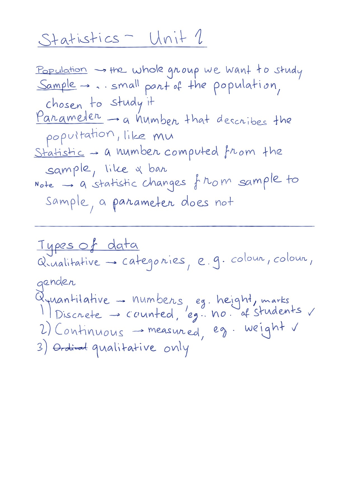
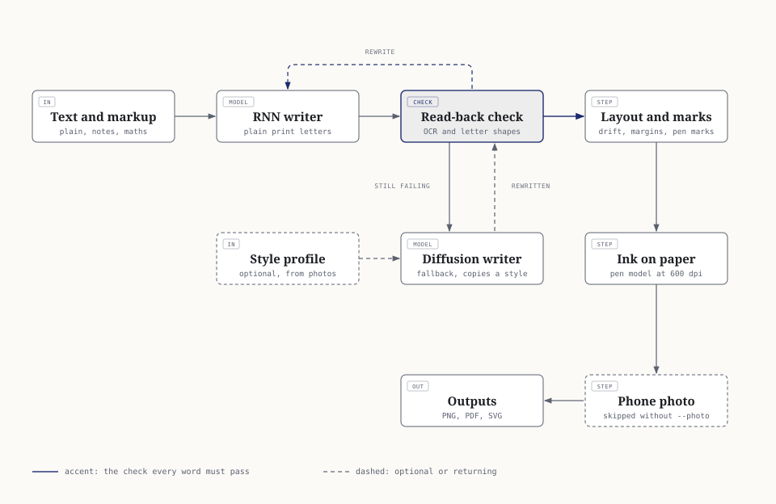
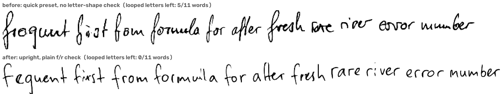

<p align="center">
  <picture>
    <source media="(prefers-color-scheme: dark)" srcset="docs/assets/banner-dark.png">
    
  </picture>
</p>

<p align="center">
  <a href="LICENSE"></a>
  
  
  
  <a href="docs/BENCHMARK.md"></a>
</p>

**ductus** turns text into handwritten A4 pages: notes with arrows and ticks, worked maths
with fractions and roots, lists, tables and plain prose. It is a 2026 successor to 2016 RNN
demos such as [greydanus/scribe](https://github.com/greydanus/scribe).

- **Letters** come from the Graves handwriting RNN, which writes plain, print-like letters.
  A one-shot diffusion model, DiffBrush (ICCV 2025), writes what the RNN cannot and can copy a
  style from a photo.
- **Every word** is read back by OCR and written again if it does not read.
- **The page** gets a layout, pen and ink model, and optionally a phone-photo look, so it looks
  like a person wrote it on paper.

*Ductus* is the palaeographers' word for the way a hand moves to form letters.

## Status

Early, and small. What is true today:

- It reads well on plain prose. On the 7-line test in [docs/BENCHMARK.md](docs/BENCHMARK.md) it
  is level with fonts on the prose lines but behind a handwriting font and the 2018 RNNs on
  average, mostly because of the maths line.
- It is slow on a CPU compared with fonts and RNNs, because of the OCR read-back.
- It never repeats an identical letter shape (glyph twin rate 0.000 in the benchmark); fonts
  do.
- Maths and notes layouts, a personal style profile and a phone-photo look are things the
  tools in that benchmark do not have.
- The tests are small: 7 lines, one sample each. Treat the numbers as indications.

## Quick start

```bash
git clone https://github.com/PrafullJ0shi/ductus && cd ductus
pip install -e ".[model,pdf]"
# plain RNN letters (the default writer): the pretrained model and a Python with TensorFlow 2
git clone https://github.com/Grzego/handwriting-generation ~/.cache/ductus/handwriting-generation
export DUCTUS_RNN_PYTHON=/path/to/python-with-tensorflow
ductus write examples/definitions.txt -o out/defs --mode notes
```

This writes `out/defs.png` and `out/defs.pdf` (A4, 300 dpi) and prints a JSON line with
statistics. Requires Python 3.10 or newer; no GPU is needed.

The first run downloads the DiffBrush checkpoint (1.2 GB), the Stable Diffusion 1.5 VAE and
TrOCR from public links; no account is needed. The RNN runs as a separate process with the
Python in `DUCTUS_RNN_PYTHON`, from the checkout in `~/.cache/ductus/handwriting-generation`
or `$DUCTUS_RNN_DIR`. Without the RNN, ductus uses the diffusion writer for every word: slower
and less readable (round 1 in the benchmark).

## Examples

| Definitions (notes mode) | Worked example (maths mode) |
|---|---|
|  |  |
| **Checklist** | **Intro** |
|  |  |

More in [`samples/`](samples): neat and messy looks, grid and ruled paper, and a phone photo.
`scripts/make_samples.py` makes them from the files in [`examples/`](examples).

Clean page and phone photo, with `--photo a4` and `--photo notebook`:


## Usage

```bash
ductus write examples/definitions.txt -o out/defs --mode notes
ductus write examples/maths.txt -o out/maths --mode maths --paper grid
ductus write --text "Hello from ductus" -o out/hello --pen fountain --animate
ductus write notes.txt -o out/photo --photo --pen black-gel --tip 0.7      # loose A4 sheet
ductus write notes.txt -o out/pad --photo notebook                          # spiral grid notebook

# your own hand: build a profile from photos of your pages, then write with it
ductus style page1.jpg page2.jpg page3.jpg -o styles/my-hand
ductus write notes.txt -o out/mine --style styles/my-hand --look profile --mode notes
```

Profiles are personal data and are ignored by git (`styles/`). See
[docs/STYLE_GUIDE.md](docs/STYLE_GUIDE.md).

### Options for `ductus write`

The main options are below. Every option, with defaults, is in [docs/CLI.md](docs/CLI.md); the
markup (`Term :: meaning`, `{a/b}`, `[v]` and more) is in [docs/CLI.md#markup](docs/CLI.md#markup).

| Option | Values (default in bold) | Effect |
|---|---|---|
| `--mode` | **`plain`**, `notes`, `maths` | what markup is understood and how blocks are laid out |
| `--look` | `neat`, **`natural`**, `messy`, `profile` | how much human variation is added; `profile` uses the measured habits of `--style` |
| `--style` | **`upright`**, `slant`, `quick`, `round`, `loose`, a line image, a profile folder | reference for size, spacing and (with the diffusion writer) letter shapes |
| `--engine` | **`default`**, `rnn`, `diffusion`, `auto` | which writer; `default` is RNN letters with diffusion as fallback |
| `--legibility` | **`strict`**, `loose` | `strict`: every word must pass the line and the word OCR read-back |
| `--allow-loops` | off | keep looped `f`, stylish `r` and looped ascenders (otherwise they are rewritten plainly) |
| `--pen` | **`blue-ballpoint`**, `black-ballpoint`, `blue-gel`, `black-gel`, `fountain`, `pencil` | colour, texture and line width; see [docs/PENS.md](docs/PENS.md) |
| `--tip` | `0.5`, `0.7`, `1.0` (mm) | nominal tip size, which sets the line width |
| `--weight` | **`1.0`** | stroke weight multiplier on top of the pen |
| `--ink` | `#rrggbb` | override the pen's ink colour |
| `--ink-model` | **`realism`**, `pens`, `flat` | how ink is drawn; see [docs/INK.md](docs/INK.md) |
| `--paper` | **`white`**, `ruled`, `grid` | grid is the default with `--photo notebook` |
| `--photo` | `a4`, `notebook` | phone photo of the page; `--photo` alone means `a4` |
| `--humanize` | `0` to `1`, **`0.5`** | rate of the human-error pass; ignored for `--look neat` |
| `--corrections` | rate | share of words written wrong, struck out and rewritten |
| `--size` | mm, **`2.8`** | x-height of the writing |
| `--seed` | integer, **`0`** | same input, options and seed give the same page |
| `--no-verify`, `--no-cache` | off | skip the OCR check; do not reuse generated words |
| `--svg`, `--animate`, `--no-pdf` | off | also write an SVG, an animated SVG, or skip the PDF |

## How it works

<picture>
  <source media="(prefers-color-scheme: dark)" srcset="docs/diagrams/architecture-dark.svg">
  
</picture>

1. Markup is parsed into notebook blocks. All words are packed into ordinary 46-character
   carrier sentences, because line models write full lines best.
2. The RNN writes the carriers; each line is cut back into words.
3. Each word is read back by OCR and checked for plain letter shapes. Wrong words are rewritten
   in new carriers, 4 rounds with the RNN and 2 more with diffusion. A word that still fails is
   used anyway and counted in `still_failing` in the printed statistics.
4. The layout places the words and draws marks with human variation; the ink model renders the
   page; the optional camera model photographs it.

More in [docs/ARCHITECTURE.md](docs/ARCHITECTURE.md), [docs/METHOD.md](docs/METHOD.md) and
[docs/RESEARCH.md](docs/RESEARCH.md) (a survey of 2013 to 2026 methods and why this one).

## Plain letters

The default hand is plain, print-like writing. A letter-shape check rewrites words whose `f`,
`r` or ascenders come out looped or calligraphic, and every word must pass the OCR read-back.
Messiness stays in spacing, baseline, slant and size rather than in the letters.



## Pens and ink

Six pens (two ballpoints, two gels, a fountain pen and a pencil) with three tip sizes. Each pen
has its own colour, line width and texture. The page is inked at 600 dpi: speed-dependent
density, blobs, skips, rough edges and darker overlaps, mixed with the paper by the
Beer-Lambert law. See [docs/PENS.md](docs/PENS.md) for the numbers and
[docs/INK.md](docs/INK.md) for the method.


## Phone photo

Without `--photo` the output is a clean white A4 page. With it, the page is photographed by a
simulated phone camera: sheet on a desk, perspective, light falloff and shadow, white balance,
defocus, sensor noise, sharpening and JPEG. The parameters are measured from a real phone photo
of handwritten notes (`src/ductus/realism/calibration.json`).

- `--photo a4` (the default photo): one loose white A4 sheet on a desk. No spiral or grid; a
  corner or edge lifts slightly and casts a soft shadow.
- `--photo notebook`: a spiral-bound grid pad with pages below and curl at the binding. Grid
  paper is the default here; `--paper` overrides it.

Details and sources: [docs/REALISM.md](docs/REALISM.md#g-the-realism-package-srcductusrealism).

## Results

From [docs/BENCHMARK.md](docs/BENCHMARK.md): 7 test lines, one sample each, judged by
`trocr-large-handwritten` (a different OCR model from the one ductus uses for its own check).
Normalised character error rate on the 4 main lines (short sentence, definition, maths,
pangram); lower reads better. The ductus rows are rounds 1 to 4 of the same benchmark; machine
load differed between rounds, so the speed column is only a rough guide.

| System | norm CER | Capitals | Digits | Repeated glyphs | s per line (CPU) |
|---|---|---|---|---|---|
| Handwriting font (Caveat, via text-to-handwriting) | **0.000** | 0.000 | 0.037 | 46% of shapes | 0.7 |
| sjvasquez RNN (2018) | 0.084 | 1.500 | 0.482 | 0% | 2.7 |
| **ductus, current (round 5)** | **0.038** | **0.000** | 0.037 | 0% | 12 |
| ductus, round 4 (template numbers, symbols, capitals) | 0.122 | 0.000 | 0.037 | 0% | 77 (loaded machine) |
| ductus, round 3 (cursive r/f, template M/R/H/E/N) | 0.093 | 0.136 | 0.111 | 0% | 38 |
| ductus, round 2 (RNN letters + diffusion fallback) | 0.113 | 0.227 | 0.185 | 0% | 23 |
| Grzego RNN (2018) | 0.124 | 0.591 | 0.111 | 0% | 5.2 |
| ductus, round 1 (diffusion letters) | 0.148 | 0.000 | 0.333 | 0% | 390 |

What this says, without spin:

- Rounds 4 and 5 drew numbers, symbols and capitals from templates and fixed a wrapped test
  line: capitals 0.000, digits 0.037 (level with the fonts), maths 0.150. The remaining maths
  error is the judge not reading drawn `=` marks and stacked fractions.
- It is ahead of the 2018 RNNs on these lines (0.038 against 0.084 and 0.124) but not level with a font, and it is slower than both on a loaded machine.
- n = 7 lines; a single bad word moves a line's CER by 10 to 15 points.
- An earlier 40-sentence evaluation of the diffusion-only version, and a blind real-versus-
  generated test that is not yet at chance, are in [docs/EVALUATION.md](docs/EVALUATION.md)
  and [docs/COMPARISON.md](docs/COMPARISON.md).

## Versus and blind test

- [docs/VERSUS.md](docs/VERSUS.md): the same text from a handwriting font, two RNNs and ductus,
  with readability, repetition and speed side by side.
- [docs/BLIND_TEST.md](docs/BLIND_TEST.md): can a classifier tell real handwriting from ductus?
  So far it can, every time. Results, method and caveats are published
  ([`benchmark/blind_test.csv`](benchmark/blind_test.csv)).
- [docs/WHY_DUCTUS.md](docs/WHY_DUCTUS.md): ten differences from a font and from the 2018
  RNNs, each with a measured number or a file, and what it does not do yet.

## Limits

- Characters outside the writers' alphabet are drawn as marks or replaced by close ASCII forms.
  Accented letters and currency signs are not written.
- Maths is limited to the markup in [docs/CLI.md](docs/CLI.md#markup); it is not a LaTeX
  renderer.
- A personal profile copies size, spacing, slant, ink and habits. Letter shapes are copied only
  with `--engine diffusion` or `auto`, at a cost in speed and readability.
- The output is not guaranteed to fool a person or a detector. See
  [docs/EVALUATION.md](docs/EVALUATION.md).

## Documentation

| Page | Content |
|---|---|
| [docs/CLI.md](docs/CLI.md) | every option, markup and the Python API |
| [docs/PAGES.md](docs/PAGES.md) | hand-ruled page borders and margin lines |
| [docs/ARCHITECTURE.md](docs/ARCHITECTURE.md) | modules, writers and data flow |
| [docs/METHOD.md](docs/METHOD.md) | carriers, read-back, layout, rendering |
| [docs/PENS.md](docs/PENS.md) | pen presets and tip sizes |
| [docs/INK.md](docs/INK.md) | the ink model |
| [docs/HABITS.md](docs/HABITS.md) | the writer profile and habits |
| [docs/STYLE_GUIDE.md](docs/STYLE_GUIDE.md) | writing in your own hand |
| [docs/REALISM.md](docs/REALISM.md) | 72 realism details with sources and status |
| [docs/BENCHMARK.md](docs/BENCHMARK.md) | readability and speed against other tools |
| [docs/EVALUATION.md](docs/EVALUATION.md) | earlier legibility, repetition, speed and blind test |
| [docs/COMPARISON.md](docs/COMPARISON.md) | this project against other tools |
| [docs/VERSUS.md](docs/VERSUS.md) | one text from a font, two RNNs and ductus, side by side |
| [docs/BLIND_TEST.md](docs/BLIND_TEST.md) | real versus generated handwriting, classifier results |
| [docs/WHY_DUCTUS.md](docs/WHY_DUCTUS.md) | ten differences from fonts and the 2018 RNNs, with evidence |
| [docs/RESEARCH.md](docs/RESEARCH.md) | survey of handwriting generation, licences, choice of engine |
| [docs/FAQ.md](docs/FAQ.md) | common questions |
| [docs/PLAN.md](docs/PLAN.md) | project plan and status |
| [CONTRIBUTING.md](CONTRIBUTING.md), [CHANGELOG.md](CHANGELOG.md), [DESIGN.md](DESIGN.md) | contributing, changes, visual rules for docs |

## V2 roadmap

Ten features planned for the next major version, in rough order. Items marked *revenue* are
ways the project can pay for its own compute.

1. **Fine-tune on your own pages.** A short LoRA fine-tune of the style encoder and UNet on
   the line crops from `ductus style`, so personal glyphs (your `g`, your `7`) are copied, not
   approximated. Runs on a free Colab GPU in about 20 minutes.
2. **Full character set.** Train the content encoder on a wider glyph set so `=`, `%`, `@`,
   `<`, `>`, accented Latin and currency signs are written by the model instead of drawn as
   marks or replaced.
3. **GPU and Apple Silicon paths.** CUDA and MPS back ends with half precision and a batched
   DDIM sampler: a page in seconds instead of minutes.
4. **Stroke output.** Vectorise generated words into centre-line pen paths, so pen plotters
   (AxiDraw and similar) can write the page with a real pen, and the animated SVG follows the
   real stroke order.
5. **Hosted web app** (*revenue*). A free tier for short notes in preset styles, and a paid
   tier for personal styles, full pages, PDF export and priority GPU queue.
6. **Pen-plotter card service** (*revenue*). Upload a style once; order greeting cards,
   thank-you notes or letters that a plotter writes in real ink and posts.
7. **REST API and SDKs** (*revenue*). `POST /write` with text, style and options; returns PNG,
   PDF or SVG. Metered usage for app builders (note-taking apps, design tools, education).
8. **Style marketplace** (*revenue*). Writers publish consented, verified style profiles and
   earn a share each time their style is used. Consent and identity checks are built in;
   signatures are never offered.
9. **Editor plug-ins.** Figma, Canva, Notion and Obsidian plug-ins that turn a text block into
   handwriting in place, plus a LaTeX/Markdown importer for full maths notation.
10. **Provenance by default.** An invisible watermark and a C2PA manifest in every output, and
    a public detector, so generated pages can always be identified. This keeps the tool on the
    right side of academic and legal use.

## Responsible use

Write your own hand or one you have permission to use. Do not imitate signatures or hand in
generated pages as someone's own work. A provenance watermark is on the roadmap.

## Credits and licences

- ductus code: MIT, see [LICENSE](LICENSE).
- [DiffBrush](https://github.com/dailenson/DiffBrush) (Dai et al., ICCV 2025): network code
  vendored under MIT in `src/ductus/engines/diffbrush/`. Its weights are downloaded at first
  use, not shipped; they were trained on the IAM database, which is licensed for
  non-commercial research.
- [Stable Diffusion 1.5 VAE](https://huggingface.co/stable-diffusion-v1-5/stable-diffusion-v1-5) (CreativeML OpenRAIL-M).
- [TrOCR](https://huggingface.co/microsoft/trocr-base-handwritten) (MIT).
- Style presets drawn with [Grzego/handwriting-generation](https://github.com/Grzego/handwriting-generation) (MIT).
- [GNU Unifont](https://unifoundry.com/unifont/) glyphs for the content encoder (OFL / GPL with font exception).
- Inspired by [greydanus/scribe](https://github.com/greydanus/scribe) and Graves,
  [Generating Sequences With Recurrent Neural Networks](https://arxiv.org/abs/1308.0850) (2013).

If you use ductus in research, see [CITATION.cff](CITATION.cff).
