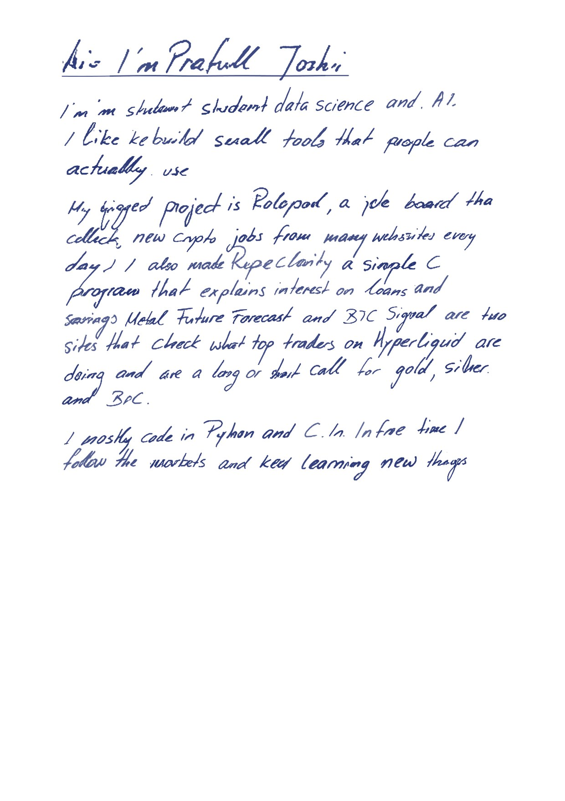
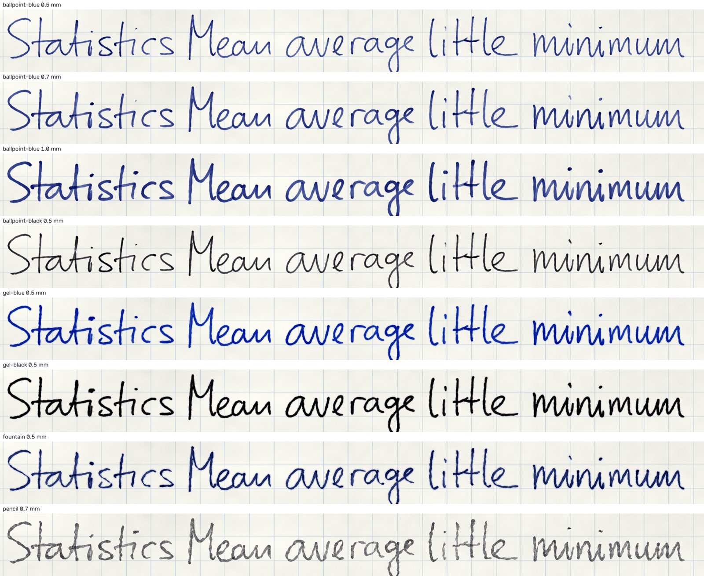
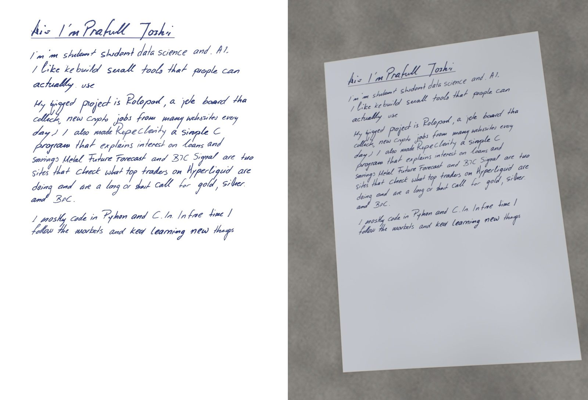
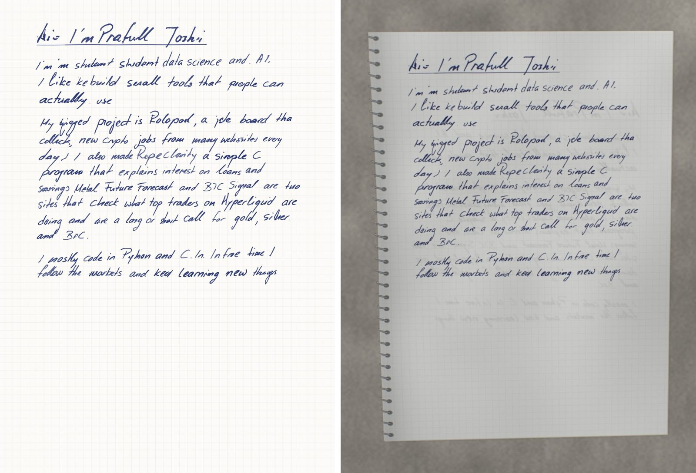

<p align="center">
  <picture>
    <source media="(prefers-color-scheme: dark)" srcset="docs/assets/banner-dark.png">
    
  </picture>
</p>

<p align="center">
  <a href="LICENSE"></a>
  
  
  <a href="https://github.com/dailenson/DiffBrush"></a>
</p>

**ductus** turns text into handwritten A4 pages: notes with arrows and ticks, worked maths
with fractions and roots, lists, tables and plain prose, in a style copied from a photo of
real writing. It is a 2026 successor to the 2016 RNN demos such as
[greydanus/scribe](https://github.com/greydanus/scribe): a one-shot diffusion model writes
the words, an OCR read-back rewrites the ones that come out wrong, and a layout and ink model
add the habits of a person writing on paper.

*Ductus* is the palaeographers' word for the way a hand moves to form letters.

## What it does

- **Any style from one photo.** Give a line image, or build a profile from photos of your
  own pages with `ductus style`.
- **Notes and maths layouts.** `Term :: meaning` definitions with arrows, `Note:` lines,
  numbered lists with ticks and crosses, headings with drawn rules, `{a/b}` fractions,
  `sqrt()`, sigma, superscripts, tables with ruled columns, circled answers, `=` lines aligned
  under each other.
- **Checked spelling.** Every word is read back by OCR and regenerated when it is wrong.
- **Human habits.** Baseline drift, wandering margins, uneven spacing, size growth toward the
  end of a page, squeezed words at line ends, the odd crossed-out slip, retraced words,
  smudges. Each detail is listed with its source in [docs/REALISM.md](docs/REALISM.md).
- **Real ink.** Ballpoint, gel, fountain pen or pencil, with speed-dependent density, blobs,
  skips, rough edges and darker overlaps ([docs/INK.md](docs/INK.md)).
- **Paper and camera.** White A4 (default), ruled or 5 mm grid. `--photo a4` (a loose sheet
  on a desk, the default photo) or `--photo notebook` (a spiral grid pad) simulates a phone
  picture with keystone, curl, shadow, white balance, noise and JPEG, calibrated on a real one.
- **Outputs.** 300 dpi PNG, PDF, SVG and an SVG that writes itself.

## Before and after

The same text written by the 2016-era Graves RNN (left, pretrained
[Grzego/handwriting-generation](https://github.com/Grzego/handwriting-generation), one
sample per line) and by ductus (right).


The RNN writes clean lowercase prose but breaks on capitals and digits ("BTC" became "Baer",
"RupeeClarity" became "Rupeellarity"). ductus writes them, lays out the page and copies a
style from an image. Measured differences are below.

## Gallery

| Definitions (notes mode) | Worked example (maths mode) |
|---|---|
|  |  |
| **Checklist** | **Intro** |
|  |  |

More in [`samples/`](samples): neat and messy looks, grid and ruled paper, each pen, and a
phone photo. Every sample is generated by `scripts/make_samples.py` from the files in
[`examples/`](examples).

## Measured results

All numbers come from scripts in [`scripts/`](scripts) and are explained in
[docs/EVALUATION.md](docs/EVALUATION.md) and [docs/COMPARISON.md](docs/COMPARISON.md).
Legibility is judged by `trocr-large-handwritten`, a different OCR model from the one ductus
uses for its own check. 40 sentences, the same for every system.

| System | CER | CER, normalised | Lines with CER at most 10% | Identical copies of a repeated word | Seconds per line (CPU) |
|---|---|---|---|---|---|
| Handwriting font (Caveat) | 3.2% | 0.4% | 40/40 | 42.5% (median similarity 0.92) | 0.002 |
| 2016 RNN, bias 1.5 | 6.3% | 3.5% | 37/40 | 0% | 3.1 |
| 2016 RNN, bias 2.5 | 6.8% | 4.0% | 33/40 | 0% | 4.5 |
| DiffBrush raw (2025) | 11.8% | 8.5% | 30/40 | 0% | 4.7 |
| ductus, no read-back | 19.1% | 15.7% | 18/40 | 0% | 4.6 |
| ductus natural (`quick` style) | 10.5% | 7.2% | 29/40 | 0% | 10.2 |
| **ductus neat (`upright` style)** | **6.7%** | **3.2%** | **37/40** | **0%** | 10.1 |


What the numbers say, without spin:

- ductus `neat` and the 2016 RNN are about equally legible overall. They fail differently:
  the RNN on capitals, digits and symbols; ductus on some long lowercase words.
- The OCR read-back is what makes ductus legible: without it the error is about five times
  higher.
- A handwriting font is more legible than both, and repeats every word identically.
- ductus is the slowest of the systems compared.
- A blind real-versus-generated test on writers the model never saw is not yet at chance; see
  [docs/EVALUATION.md](docs/EVALUATION.md#blind-test).

## Install

```bash
git clone https://github.com/PrafullJ0shi/ductus && cd ductus
pip install -e ".[model,pdf]"
```

The first run downloads the DiffBrush checkpoint (1.2 GB), the Stable Diffusion 1.5 VAE and
TrOCR (no account needed).

## Use

```bash
ductus write examples/definitions.txt -o out/defs --mode notes
ductus write examples/maths.txt -o out/maths --mode maths --paper grid
ductus write --text "Hello from ductus" -o out/hello --pen fountain --animate
ductus write notes.txt -o out/photo --photo --pen black-gel --tip 0.7      # loose A4 sheet
ductus write notes.txt -o out/pad --photo notebook                          # spiral grid notebook

# your own hand: build a profile from photos of your pages, then write with it
ductus style page1.jpg page2.jpg page3.jpg -o styles/my-hand
ductus write notes.txt -o out/mine --style styles/my-hand --look profile --mode notes
```

| Option | Values |
|---|---|
| `--look` | `neat`, `natural` (default), `messy`, `profile` |
| `--mode` | `plain`, `notes`, `maths` |
| `--pen` | `blue-ballpoint` (default), `black-ballpoint`, `blue-gel`, `black-gel`, `fountain`, `pencil` |
| `--tip` | `0.5`, `0.7`, `1.0` mm |
| `--paper` | `white` (default), `ruled`, `grid` (default with `--photo notebook`) |
| `--photo` | `a4` (default when given alone), `notebook` |
| `--ink-model` | `realism` (default), `pens`, `flat` |
| `--humanize` | rate of the human-error pass, `0` to `1` (default `0.5`; off for `neat`) |

Full reference: [docs/CLI.md](docs/CLI.md). Markup cheat sheet: [docs/CLI.md#markup](docs/CLI.md#markup).

## Pens



Each pen has its own colour, line width, pressure response and texture. The ink model
renders the pen's path at 600 dpi and deposits ink by speed, pauses and overlaps, then
mixes it with the paper by the Beer-Lambert law. Details in [docs/INK.md](docs/INK.md).

## Phone photo

Without `--photo` the output is a clean white A4 page. With it, the page is photographed by a
simulated phone camera: sheet on a desk, perspective, light falloff and shadow, white balance,
defocus, sensor noise, sharpening and JPEG, in that order, with parameters measured from a real
phone photo of handwritten notes (`src/ductus/realism/calibration.json`).

**`--photo a4`** (default): one loose white A4 sheet on a desk. No spiral or grid; a corner or
edge lifts slightly off the desk and casts a soft shadow.



**`--photo notebook`**: a spiral-bound grid pad with pages below and curl at the binding. Grid
paper is the default here; `--paper` overrides it.



Details and sources: [docs/REALISM.md](docs/REALISM.md#g-the-realism-package-srcductusrealism).

## How it works

<picture>
  <source media="(prefers-color-scheme: dark)" srcset="docs/diagrams/pipeline-dark.png">
  
</picture>

1. Markup is parsed into notebook blocks; all words are packed into ordinary 46-character
   carrier sentences, because the model writes full lines best.
2. DiffBrush writes the carriers in the reference style; each line is cut back into words.
3. Each word is read back by TrOCR; wrong words are rewritten in new carriers (up to 5
   rounds).
4. The layout places words and draws marks with human variation; the ink model renders the
   page.

More: [ARCHITECTURE](docs/ARCHITECTURE.md), [METHOD](docs/METHOD.md),
[RESEARCH](docs/RESEARCH.md) (survey of 2013 to 2026 methods and why this one).

## Documentation

| Page | Content |
|---|---|
| [docs/RESEARCH.md](docs/RESEARCH.md) | survey of handwriting generation, licences, choice of engine |
| [docs/METHOD.md](docs/METHOD.md) | carriers, read-back, layout, rendering |
| [docs/ARCHITECTURE.md](docs/ARCHITECTURE.md) | modules and data flow |
| [docs/STYLE_GUIDE.md](docs/STYLE_GUIDE.md) | writing in your own hand |
| [docs/HABITS.md](docs/HABITS.md) | the writer habit profile |
| [docs/REALISM.md](docs/REALISM.md) | 72 realism details with sources and status |
| [docs/INK.md](docs/INK.md) | pens and the ink model |
| [docs/EVALUATION.md](docs/EVALUATION.md) | legibility, repetition, speed, blind test |
| [docs/COMPARISON.md](docs/COMPARISON.md) | this project against other tools |
| [docs/CLI.md](docs/CLI.md) | command line, markup and Python API |
| [docs/FAQ.md](docs/FAQ.md) | common questions |
| [docs/PLAN.md](docs/PLAN.md) | project plan and status |

## V2 roadmap

Ten features planned for the next major version, in rough order. Items marked *revenue* are
ways the project can pay for its own compute.

1. **Fine-tune on your own pages.** A short LoRA fine-tune of the style encoder and UNet on
   the line crops from `ductus style`, so personal glyphs (your `g`, your `7`) are copied, not
   approximated. Runs on a free Colab GPU in about 20 minutes.
2. **Full character set.** Train the content encoder on a wider glyph set so `=`, `%`, `@`,
   `<`, `>`, accented Latin and the rupee sign are written by the model instead of drawn as
   marks or replaced.
3. **GPU and Apple Silicon paths.** CUDA and MPS back ends with half precision and a batched
   DDIM sampler: a page in seconds instead of minutes.
4. **Stroke output.** Vectorise generated words into centre-line pen paths, so pen plotters
   (AxiDraw and similar) can write the page with a real pen, and the animated SVG follows the
   real stroke order.
5. **Hosted web app** (*revenue*). A free tier for short notes in preset styles, and a paid
   tier for personal styles, full pages, PDF export and priority GPU queue.
6. **Pen-plotter card service** (*revenue*). Upload a style once; order greeting cards,
   thank-you notes or letters that a plotter writes in real ink and posts.
7. **REST API and SDKs** (*revenue*). `POST /write` with text, style and options; returns PNG,
   PDF or SVG. Metered usage for app builders (note-taking apps, design tools, education).
8. **Style marketplace** (*revenue*). Writers publish consented, verified style profiles and
   earn a share each time their style is used. Consent and identity checks are built in;
   signatures are never offered.
9. **Editor plug-ins.** Figma, Canva, Notion and Obsidian plug-ins that turn a text block into
   handwriting in place, plus a LaTeX/Markdown importer for full maths notation.
10. **Provenance by default.** An invisible watermark and a C2PA manifest in every output, and
    a public detector, so generated pages can always be identified. This keeps the tool on the
    right side of academic and legal use.

## Responsible use

Write your own hand or one you have permission to use. Do not imitate signatures or hand in
generated pages as someone's own work. A provenance watermark is on the roadmap.

## Credits and licences

- ductus code: MIT, see [LICENSE](LICENSE).
- [DiffBrush](https://github.com/dailenson/DiffBrush) (Dai et al., ICCV 2025): network code
  vendored under MIT in `src/ductus/engines/diffbrush/`. Its weights are downloaded at first
  use, not shipped; they were trained on the IAM database, which is licensed for
  non-commercial research.
- [Stable Diffusion 1.5 VAE](https://huggingface.co/stable-diffusion-v1-5/stable-diffusion-v1-5) (CreativeML OpenRAIL-M).
- [TrOCR](https://huggingface.co/microsoft/trocr-base-handwritten) (MIT).
- Style presets drawn with [Grzego/handwriting-generation](https://github.com/Grzego/handwriting-generation) (MIT).
- [GNU Unifont](https://unifoundry.com/unifont/) glyphs for the content encoder (OFL / GPL with font exception).
- Inspired by [greydanus/scribe](https://github.com/greydanus/scribe) and Graves,
  [Generating Sequences With Recurrent Neural Networks](https://arxiv.org/abs/1308.0850) (2013).

If you use ductus in research, see [CITATION.cff](CITATION.cff).
