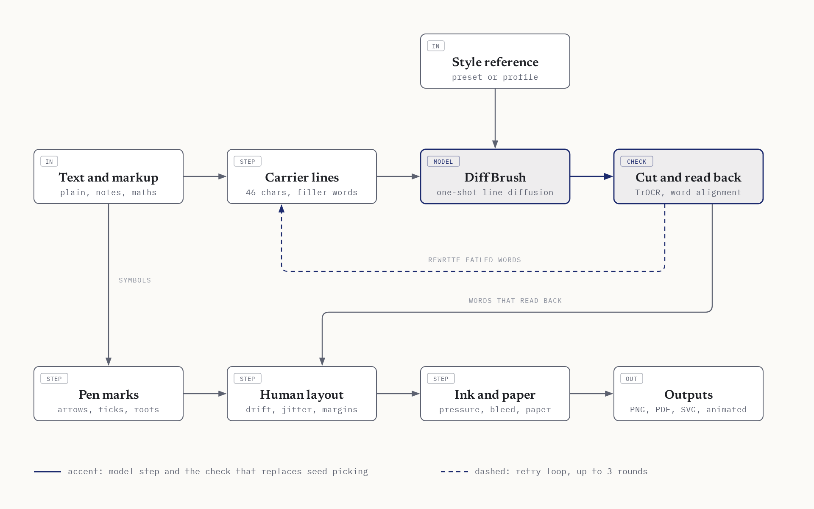

# Architecture

<picture>
  <source media="(prefers-color-scheme: dark)" srcset="diagrams/pipeline-dark.png">
  
</picture>

Source of the diagram: [`diagrams/build_diagrams.py`](diagrams/build_diagrams.py) (HTML with inline SVG,
checked with the diagram-design kit's `self_check.py` and `verify_geometry.py`).

## Modules

| Module | Role |
|---|---|
| `markup.py` | Parses text into blocks (heading, definition, note, list item, table, maths line, rule) and inline tokens (words with decorations, symbols, fractions, roots, circles, superscripts). |
| `engines/diffbrush/` | The vendored DiffBrush network (MIT) and a CPU wrapper: weights download, style and content tensors, DDIM sampling, VAE decode. |
| `synth.py` | Packs words into carrier lines, generates them in batches, splits lines back into words, reads them back with OCR, rewrites failures. |
| `verify.py` | TrOCR reader, character error rate, normalisation. |
| `segment.py` | Ink maps, word splitting, baseline and x-height, stroke width, skew, line finding. |
| `pen.py` | Pen marks as strokes: arrows, ticks, crosses, `=`, `<`, `>`, `%`, sigma, radicals, fraction bars, underlines, strike-throughs, circles, rules. |
| `layout.py` | Box model and page flow with human variation; notebook structures; multi-page. |
| `render.py` | Ink coverage, pressure field, paper blend, PNG, PDF, SVG and animated SVG. |
| `paper.py` | White, ruled and grid paper; phone-photo look. |
| `profile.py` | Personal style profile from photos. |
| `page.py` | Orchestration (`Writer.write`, `write_lines`). |
| `cli.py` | `ductus write`, `ductus style`, `ductus presets`. |

## Data flow in one page

1. `markup.parse` returns blocks. Corrections (`{oops:word}` or the `corrections` rate) are
   inserted as extra struck-out words.
2. All words are listed in layout order. `Synthesizer` packs them into 46-character
   carriers, adds filler words to reach the length, and generates 8 carriers per batch.
3. Each carrier image is cleaned, split at the widest gaps (one more gap than real words is
   not needed because filler words are counted), and read back:
   line OCR is aligned to the target words with an edit-distance DP; each word crop is also
   read on its own; the acceptance error is the mean of both, plus a width sanity check.
4. Failed words go to the next round in new carriers with a new seed (3 rounds by default).
5. `Layouter` turns blocks into boxes. Words keep the baseline the model gave them; the
   layout adds line drift, margin wander, gap and size jitter and small rotations. Pen marks
   are drawn at the measured stroke width of the writing.
6. `render` composites everything at 600 dpi, applies the pressure field and a slight bleed,
   multiplies the ink colour onto the paper and downsamples to 300 dpi.

## Why carriers and not one call per line of the page

A page line in notes mode is interrupted by arrows, fractions, ticks and table rules. The model
cannot draw those, and splitting a line into short runs moves it out of its training range.
Carriers decouple generation from layout: the model always writes ordinary sentences, and the
layout is free to put words anywhere.

## Performance (8 CPU cores, no GPU)

Measured on the showcase pages: about 3.5 s per carrier line (25 DDIM steps, batch of 8) plus
about 1 s of OCR per carrier. A page of 150 to 250 words takes 1 to 3 minutes. See
[EVALUATION.md](EVALUATION.md) for the exact numbers.
