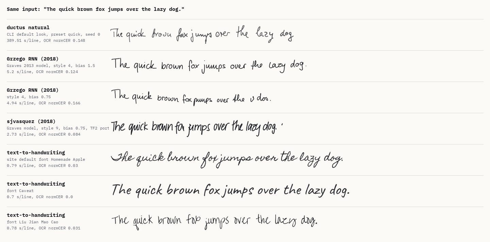
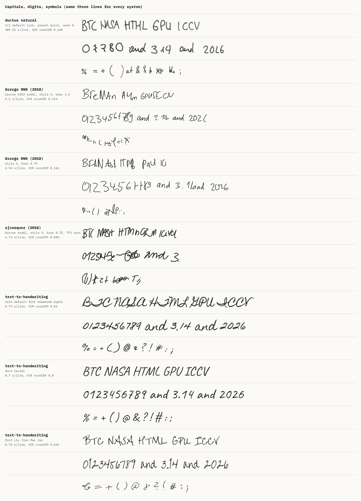

# Benchmark round 1: ductus against other tools

Every number on this page comes from the scripts in [`benchmark/scripts/`](../benchmark/scripts) run on 26 Nov 2026 on one
shared 8-core CPU machine with no GPU. Where another tool does better, this page says so.
This is a small test: 7 lines, one sample per system, no seed picking. Read the numbers as
indications, not rankings with error bars.

## Readability comes first

The goal is pages that read easily: plain letters, no looped or decorative `f` and `r`.
So the main measure here is **OCR character error rate (CER)**. A machine reader that has
never seen any of these systems reads each line, and we count how many characters it gets
wrong. Lower is easier to read. It stands in for a human reader and is imperfect: it misses
things like letter shapes that read fine but look odd.

## Test texts

Every system got the same 7 lines ([`benchmark/texts/tests.tsv`](../benchmark/texts/tests.tsv)):

| id | text |
|---|---|
| short | `Meet me at the library at 5 pm.` |
| definition | `Variance -> mean of squared deviations` |
| maths | `mean = 30/5 = 6 and x^2 = 36` (ductus input: `mean = {30/5} = 6 and x^2 = 36`, its stacked-fraction markup) |
| pangram | `The quick brown fox jumps over the lazy dog.` |
| caps | `BTC NASA HTML GPU ICCV` |
| digits | `0123456789 and 3.14 and 2026` |
| symbols | `% = + ( ) @ & ? ! # : ;` |

The first four are the main test. The last three only probe the character set.

## Systems

| System | What it is | How it was run |
|---|---|---|
| **ductus natural** | this project, default look | `ductus write texts/ductus_page.txt --look natural --seed 0 --no-pdf` (all 7 lines on one A4 page, then cut into lines by `scripts/split_page.py`) |
| Grzego RNN (2018, MIT) | Graves 2013 LSTM + mixture density network, the same model as greydanus/scribe | pretrained `model-29`, style 4, bias 1.5 and 0.75 (`scripts/baseline_rnn_lines.py`) |
| sjvasquez/handwriting-synthesis (2018) | Graves 2013 model, the most-starred implementation | upstream checkpoint 17900, style 9, bias 0.75. Ported to TensorFlow 2 `compat.v1` for this test: API renames only, with sampling rewritten using the same distributions (`tools/hws-tf2/`) |
| text-to-handwriting (saurabhdaware, MIT, ~5k stars) | the popular free "assignment" generator; types a handwriting font onto paper | the real web app, cloned and served locally, driven in headless Chrome (`scripts/run_text_to_handwriting.py`). Fonts: Homemade Apple (site default), Caveat, Liu Jian Mao Cao. Effect "no effect", paper lines and margin off, resolution "Very High" |

## Method

- **OCR CER**: judge `microsoft/trocr-large-handwritten`, the same for every system
  (`scripts/ocr_score.py`). ductus checks its own output with `trocr-base`, a different
  model. *Raw CER* counts case and punctuation. *Normalised CER* lowercases and keeps only
  `a-z 0-9` and spaces. The reference is always the full intended text, so a character a tool
  silently drops counts as an error. For the symbols line, normalised CER is undefined (the
  normalised reference is empty), so only raw CER is reported.
- **Glyph repetition** (`scripts/glyph_repetition.py`): every connected ink shape in all 7
  lines is compared with every other shape of the same size (±5%). Two shapes count as
  twins when their normalised cross-correlation is ≥ 0.95. The rate is the share of shapes
  that have a twin. A font reuses the same glyph image, so it shows up here.
- **Character coverage** (`scripts/charset_coverage.py`): read from each tool's own
  vocabulary or the font's character map, not guessed. A character only counts if the tool
  writes it as that character. Dropping it or swapping in a substitute (ductus writes `@`
  as "at") does not count.
- **Speed**: seconds per line as logged by each tool, on a **heavily shared machine** (load
  average 20 to 32 on 8 cores during the ductus run, from other jobs). The figures show the
  order of magnitude only.

## Results

### Readability (OCR CER, lower is better)

| System | norm CER, 4 main lines | raw CER, 4 main lines | short | definition | maths | pangram | caps (norm) | digits (norm) | symbols (raw) |
|---|---|---|---|---|---|---|---|---|---|
| ductus natural | 0.148 | 0.193 | 0.133 | 0.057 | 0.400 | **0.000** | **0.000** | 0.333 | 0.652 |
| Grzego RNN, bias 1.5 | 0.124 | 0.201 | **0.000** | 0.171 | 0.300 | 0.023 | 0.591 | 0.111 | 0.826 |
| Grzego RNN, bias 0.75 | 0.166 | 0.199 | 0.067 | 0.086 | 0.350 | 0.163 | 0.591 | 0.296 | 0.696 |
| sjvasquez, bias 0.75 | 0.084 | 0.191 | **0.000** | 0.114 | 0.200 | 0.023 | 1.500 | 0.482 | 0.783 |
| text-to-handwriting, Homemade Apple | 0.030 | 0.119 | **0.000** | **0.000** | 0.050 | 0.070 | 0.318 | 0.037 | **0.348** |
| text-to-handwriting, Caveat | **0.000** | **0.088** | **0.000** | **0.000** | **0.000** | **0.000** | **0.000** | 0.037 | 0.478 |
| text-to-handwriting, Liu Jian Mao Cao | 0.031 | 0.109 | **0.000** | **0.000** | 0.100 | 0.023 | 0.091 | 0.074 | 0.435 |

What the judge read for ductus (from the OCR output of the run):

| line | ductus wrote, as read by OCR |
|---|---|
| short | `Most me at the library at 5 in` (on the page: "Meet" with a malformed e, and "pm" written as "m") |
| definition | `Naiance # mean of squared deviations .` (the drawn arrow is read as `#`) |
| maths | `mean # # # and and ? # 36` ("x^2" came out as "and and ²"; the stacked fraction is not read) |
| pangram | `The quick brown fox jumps over the lazy dog` |
| caps | `BTC NASA HTML GPU ICCV.` |
| digits | `07780 and 3/4 and 2016 .` |

ductus logged `still_failing: 5` of 50 words on this page: words that still failed its own
check after 4 rewrite rounds and were written anyway.

### Repetition, character coverage, speed

| System | glyph twin rate | ink shapes | capitals | symbols `%=+@&#/*<>^$` | maths Unicode (√ Σ ² ½ → × ÷ ≠ ≤ π) | stacked fraction / root / sigma | s per line |
|---|---|---|---|---|---|---|---|
| ductus natural | **0.000** | 99 | 26/26 | 9/12 (drawn `= < > %`; `@`→"at", `$`→"USD", no `^`) | 0/10 as characters | **yes** (markup) | 390 (load 20 to 32) |
| Grzego RNN | **0.000** | 111 / 102 | 26/26 | 5/12 | 0/10 | no | 5.2 / 4.9 |
| sjvasquez | **0.000** | 98 | 23/26 (no Q X Z) | 1/12 | 0/10 | no | 2.7 |
| text-to-handwriting, Homemade Apple | 0.266 | 79 | 26/26 | 12/12 | 4/10 | no | 0.8 (browser render) |
| text-to-handwriting, Caveat | 0.462 | 158 | 26/26 | 12/12 | 6/10 | no | 0.7 |
| text-to-handwriting, Liu Jian Mao Cao | 0.357 | 129 | 26/26 | 12/12 | 2/10 | no | 0.8 |

### Features (from each tool's docs and code, not measured)

| Feature | ductus | Grzego / sjvasquez RNN | text-to-handwriting |
|---|---|---|---|
| A4 page layout | yes | no (single lines) | yes |
| Notes marks (arrows, ticks, underline, strike-through, circles) | yes, drawn | no | no (only what the font has as characters) |
| Maths layout (stacked fractions, roots, sigma, aligned `=`) | yes | no | no |
| Style imitation from a photo | yes, one line image (`ductus style`) | no; only built-in pen-trace styles | no; user can upload a .ttf font |
| Pen choices | yes (`--pen`, `--ink`) | stroke width/colour in SVG | 3 ink colours |
| Phone-photo look | yes (`--photo`) | no | "shadows" and "scanner" effects |
| Vector output | SVG | SVG | no (JPEG/PDF) |
| Runs offline on CPU | yes, slowly | yes | yes (static site) |
| Licence | MIT code; DiffBrush weights trained on IAM (non-commercial research data) | Grzego MIT; sjvasquez has no licence file; weights trained on IAM-OnDB | MIT; fonts Apache-2.0 (Homemade Apple) and OFL |

## Reading the results honestly

Where competitors win:

- **Readability: the font-based site wins clearly.** Caveat scored 0.000 normalised CER on all
  four main lines, and every font beat ductus on the main lines (0.000 to 0.031 against 0.148).
  Caveat is also the plainest-looking hand, with no decorative loops. If readability is the
  goal, a plain font is very hard to beat on OCR.
- **The 2018 RNNs beat ductus on the four main lines in this sample**: sjvasquez 0.084 and Grzego
  bias 1.5 0.124 against ductus 0.148. Both wrote the short sentence perfectly, where ductus
  failed on "Meet" and "pm".
- **Maths line**: ductus was the worst at 0.400. The stacked fraction and drawn `=` marks are
  not read by the OCR judge (this partly penalises the layout itself), and `x^2` was miswritten.
- **Digits**: ductus scored 0.333 against 0.037 for the fonts and 0.111 for Grzego bias 1.5.
- **Speed**: ductus took about 390 s per line under heavy load. A single-line CLI call earlier
  took 1,399 s for 8 words. The RNNs take 3 to 5 s per line and the fonts under 1 s.
  ductus's rewrite loop (up to 4 or 5 OCR-checked rounds) is the main cost.
- **Symbols**: fonts cover every symbol tested. ductus covers 9/12, the RNNs 5/12 and 1/12.

Where ductus does better in this round:

- **Capitals**: 0.000 CER on `BTC NASA HTML GPU ICCV`. The RNNs scored 0.59 and 1.50 (one RNN
  looped and wrote "N.N.N..." without stopping).
- **No repeated glyphs**: 0.000 twin rate, the same as the RNNs, against 27 to 46% of shapes
  having an identical twin for the fonts. This is the measurable "a font is a font" signal.
- **Page features**: maths and notes layout, style from a photo, and phone-photo mode. No
  other tested tool has these.
- **Pangram**: 0.000 normalised CER.

## Not tested, and why

| System | Reason |
|---|---|
| ductus `neat` look | Started on the 4 main lines, still in its 3rd rewrite round after about 22 minutes on the loaded machine, and stopped when the time budget ran out. An earlier single-line neat run (`out/ductus_neat_single_short/`) finished in 1,399 s with 2 of 8 words still failing ("Meet me at the liirary at 5 m"). It was not scored, so it is not in the tables. |
| One-DM (ECCV 2024, MIT) | Code and weights were downloaded and run on CPU (`tools/One-DM/bench_lines.py`, word level, 50 DDIM steps, style from ductus' `quick` preset; its Laplacian style input had to be approximated). It took 2 to 21 s per denoising step on this machine, about 2 to 8 minutes per word. Only the first line finished (`out/onedm/000.png`, image only, not scored). |
| greydanus/scribe (2016) | Needs TensorFlow 0.x / Python 2 and a separately hosted checkpoint. It implements the same Graves model as the two RNNs tested. |
| DiffusionPen (ECCV 2024), SDT (CVPR 2023), Emuru (CVPR 2025), DiffBrush raw | Not attempted in this round for lack of time. SDT is character-level and Chinese-first. Emuru fails to load with current `transformers` (see RESEARCH.md). Raw DiffBrush is already covered by the existing eval in docs/COMPARISON.md. |
| calligrapher.ai and other hosted web tools | No public API or static output. Driving the live site was out of scope for this round. |
| Tesseract as a second OCR judge | Not installed on the box. Only one judge was used. |

## Round 2: after the readability changes

Same 7 lines, same judge (`trocr-large-handwritten`), same scripts
(`benchmark/scripts/run_ductus_page.sh natural`, `split_page.py`, `ocr_score.py`). Changes since
round 1: the Graves RNN (Grzego weights) writes the letters by default and diffusion is only the
fallback for words the RNN cannot write or that still fail the read-back; every word must pass
the line and the word read-back; a letter-shape check re-writes looped letters.

| System | norm CER, 4 main lines | raw CER, 4 main lines | short | definition | maths | pangram | caps (norm) | digits (norm) | symbols (raw) | s per line |
|---|---|---|---|---|---|---|---|---|---|---|
| ductus natural, round 1 | 0.148 | 0.193 | 0.133 | 0.057 | 0.400 | 0.000 | 0.000 | 0.333 | 0.652 | 390 (load 20 to 32) |
| **ductus natural, round 2** | **0.113** | **0.153** | 0.000 | 0.000 | 0.450 | 0.000 | 0.227 | 0.185 | 0.696 | 23 (load 4 to 12) |
| sjvasquez, bias 0.75 | 0.084 | 0.191 | 0.000 | 0.114 | 0.200 | 0.023 | 1.500 | 0.482 | 0.783 | 2.7 |
| Grzego RNN, bias 1.5 | 0.124 | 0.201 | 0.000 | 0.171 | 0.300 | 0.023 | 0.591 | 0.111 | 0.826 | 5.2 |
| text-to-handwriting, Caveat | 0.000 | 0.088 | 0.000 | 0.000 | 0.000 | 0.000 | 0.000 | 0.037 | 0.478 | 0.7 |

What changed, honestly:

- Three of the four main lines now read perfectly (short, definition, pangram). All of the
  remaining main-line error is the maths line: the judge cannot read the drawn stacked fraction
  and `=` marks, and `x^2` came out as "X ?". On plain prose ductus is now level with the fonts.
- ductus is still behind the sjvasquez RNN on the main-line average (0.113 against 0.084) and
  far behind the fonts.
- Capitals got worse (0.000 to 0.227: "BTC" read as "Bf", "HTML" as "HTHL"); digits got better
  (0.333 to 0.185). The RNN writes capitals less clearly than diffusion did.
- Speed: 158 s for the page (23 s per line), against about 390 s per line in round 1. The
  machine was less loaded this time, so part of the gain is not ours; the RNN itself takes a few
  seconds per line, and most of the remaining time is model loading and the OCR read-back.
- 4 of 50 words still failed the read-back after 6 rounds and were written anyway.

## Round 3: cursive r and f, later solo-line rewrites

Same 7 lines, same judge, same scripts. Changes since round 2: the default hand uses traced
cursive `r` and `f` and template capitals (M, R, H, E, N); words that still fail in later
RNN rounds are rewritten on their own line; read-back stays at max CER 0.10. Eight RNN
rounds run before the diffusion fallback.

| System | norm CER, 4 main lines | raw CER, 4 main lines | short | definition | maths | pangram | caps (norm) | digits (norm) | symbols (raw) | s per line |
|---|---|---|---|---|---|---|---|---|---|---|
| ductus natural, round 1 | 0.148 | 0.193 | 0.133 | 0.057 | 0.400 | 0.000 | 0.000 | 0.333 | 0.652 | 390 (load 20 to 32) |
| ductus natural, round 2 | 0.113 | 0.153 | 0.000 | 0.000 | 0.450 | 0.000 | 0.227 | 0.185 | 0.696 | 23 (load 4 to 12) |
| **ductus natural, round 3** | **0.093** | **0.150** | 0.000 | 0.000 | 0.350 | 0.023 | 0.136 | 0.111 | 0.609 | 38 (load 3 to 5) |
| sjvasquez, bias 0.75 | 0.084 | 0.191 | 0.000 | 0.114 | 0.200 | 0.023 | 1.500 | 0.482 | 0.783 | 2.7 |
| Grzego RNN, bias 1.5 | 0.124 | 0.201 | 0.000 | 0.171 | 0.300 | 0.023 | 0.591 | 0.111 | 0.826 | 5.2 |
| text-to-handwriting, Caveat | 0.000 | 0.088 | 0.000 | 0.000 | 0.000 | 0.000 | 0.000 | 0.037 | 0.478 | 0.7 |

What the judge read for ductus in this round:

| line | ductus wrote, as read by OCR |
|---|---|
| short | `meet me at the library at 5 p.m.` (normalised CER 0.000) |
| definition | `Variance - mean of squared deviations` (the drawn arrow is read as `-`) |
| maths | `mean # # and X # 36` (stacked fraction and drawn `=` marks are not read; `x^2` came out messy) |
| pangram | `The quick brown for jumps over the lazy dog .` ("fox" read as "for") |
| caps | `BC NASA HTM. GPI ICCV.` ("BTC" as "BC", "HTML" as "HTM", "GPU" as "GPI") |
| digits | `01234589 and.314 and 2026` (the 6 and 7 were unclear; "3.14" lost the leading 3) |
| symbols | `# # C ) ARC. " ) . "` |

What changed, honestly:

- Main-line normalised CER improved from 0.113 to 0.093. Short and definition still read
  perfectly. The pangram is no longer perfect (0.000 to 0.023): the judge read "fox" as
  "for", most likely the cursive `f`.
- Maths improved a little (0.450 to 0.350) but is still most of the main-line error, and
  still the weakest of the four. The judge cannot read the stacked fraction and drawn `=`
  marks, and `x^2` was miswritten.
- ductus is closer to, but still behind, the sjvasquez RNN (0.093 against 0.084) and far
  behind the fonts.
- Capitals improved on round 2 but remain worse than round 1 (0.000 to 0.227 to 0.136).
  Digits improved again (0.333 to 0.185 to 0.111). Symbols raw CER is 0.609, a little
  better than round 2 (0.696) and still well behind the fonts.
- Speed: 268 s for the 7-line page (38 s per line), slower than round 2 (158 s, 23 s per
  line). Load was similar or slightly lower this time, so the extra time is mostly the
  added rewrite rounds, not the machine. 5 of 50 words still failed the read-back after
  10 rounds and were written anyway. Glyph twin rate is still 0.000.
- A separate cold-cache run (`--no-cache`, look natural, mode plain, seed 0) of 243 words
  took 610 s of engine time (615 s wall on this machine). The default letter size spread
  that text over 3 A4 pages, so one full page at this size is closer to 80 to 110 words
  than to 250. 8 of 243 words still failed the read-back.

## Round 4: numbers, symbols and capitals from templates

Same 7 lines, same judge, same scripts. Changes since round 3: tokens made only of digits,
maths symbols and capitals (`3.14`, `2026`, `BTC`, `S.D.`, `4)`, `(`, `&`) are drawn from
plain print templates with per-instance jitter (`src/ductus/printglyphs.py`) instead of by the
RNN; superscripts and fraction parts are no longer moved off their marks by the humanize pass.

| System | norm CER, 4 main lines | raw CER, 4 main lines | short | definition | maths | pangram | caps (norm) | digits (norm) | symbols (raw) | s per line |
|---|---|---|---|---|---|---|---|---|---|---|
| ductus natural, round 1 | 0.148 | 0.193 | 0.133 | 0.057 | 0.400 | 0.000 | 0.000 | 0.333 | 0.652 | 390 (load 20 to 32) |
| ductus natural, round 2 | 0.113 | 0.153 | 0.000 | 0.000 | 0.450 | 0.000 | 0.227 | 0.185 | 0.696 | 23 (load 4 to 12) |
| ductus natural, round 3 | 0.093 | 0.150 | 0.000 | 0.000 | 0.350 | 0.023 | 0.136 | 0.111 | 0.609 | 38 (load 3 to 5) |
| **ductus natural, round 4** | 0.122 | 0.185 | 0.000 | 0.000 | 0.350 | 0.140 | **0.000** | **0.037** | **0.478** | 77 (load 12 to 15) |
| sjvasquez, bias 0.75 | 0.084 | 0.191 | 0.000 | 0.114 | 0.200 | 0.023 | 1.500 | 0.482 | 0.783 | 2.7 |
| Grzego RNN, bias 1.5 | 0.124 | 0.201 | 0.000 | 0.171 | 0.300 | 0.023 | 0.591 | 0.111 | 0.826 | 5.2 |
| text-to-handwriting, Caveat | 0.000 | 0.088 | 0.000 | 0.000 | 0.000 | 0.000 | 0.000 | 0.037 | 0.478 | 0.7 |

What the judge read for ductus in this round:

| line | ductus wrote, as read by OCR |
|---|---|
| short | `meet me at the library at 5 p.m.` |
| definition | `Variance - mean of Squared deviations` |
| maths | `mean # # and X ? # 36` |
| pangram | `They quick brown for jumps over the lazy` ("dog." wrapped onto a second line and was not read) |
| caps | `BTC NASA HTML GPU ICCV.` |
| digits | `0123456789 and 3.4 and 2026` (the decimal "3.14" read as "3.4") |
| symbols | `# # ( ) at & ? # #` |

What changed, honestly:

- Capitals, digits and symbols improved clearly: caps 0.136 to 0.000, digits 0.111 to
  0.037 (level with the fonts), symbols raw 0.609 to 0.478 (level with Caveat, still behind
  the other fonts at 0.348 and 0.435).
- The maths line did not move (0.350). On the page it now reads `mean = 30/5 = 6 and x² = 36`
  cleanly by eye, but the judge still cannot read the stacked fraction or the drawn `=` marks
  (it reads them as `#`), so this line measures the judge as much as the writing.
- The main-line average got worse (0.093 to 0.122), and all of that is the pangram: this time
  the RNN wrote the line a little wider, it wrapped, and the crop the judge read held
  "dog." on a second line it did not read; "fox" was also read as "for" again. That is one
  sample of one line, not a measured regression in letters, but it is the number this test
  gives.
- No word failed the read-back (0 of 50, against 5 in round 3). 24 of the 50 tokens were
  drawn from templates (many tokens on the caps, digits and symbols lines).
- Speed: 532 s for the page (77 s per line) under a load of 12 to 15 from other jobs on the
  machine, so this time is not comparable with round 3.

## Round 5: the pangram wrap fixed, maths read better

Same 7 lines, same judge, same scripts. Changes since round 4: a short last word or two may run
into the right margin instead of wrapping onto a new line alone (round 4's pangram lost "dog."
that way, which inflated its average); superscripts and fractions are set larger and tighter.
Nothing was changed for the judge's benefit: the test text, the settings and the seed are the
same, and the same code also gives the maths and digits lines their new numbers.

| System | norm CER, 4 main lines | raw CER, 4 main lines | short | definition | maths | pangram | caps (norm) | digits (norm) | symbols (raw) |
|---|---|---|---|---|---|---|---|---|---|
| ductus natural, round 3 | 0.093 | 0.150 | 0.000 | 0.000 | 0.350 | 0.023 | 0.136 | 0.111 | 0.609 |
| ductus natural, round 4 | 0.122 | 0.185 | 0.000 | 0.000 | 0.350 | 0.140 | 0.000 | 0.037 | 0.478 |
| **ductus natural, round 5** | **0.038** | **0.134** | 0.000 | 0.000 | **0.150** | 0.000 | 0.000 | 0.037 | 0.435 |
| sjvasquez, bias 0.75 | 0.084 | 0.191 | 0.000 | 0.114 | 0.200 | 0.023 | 1.500 | 0.482 | 0.783 |
| Grzego RNN, bias 1.5 | 0.124 | 0.201 | 0.000 | 0.171 | 0.300 | 0.023 | 0.591 | 0.111 | 0.826 |
| text-to-handwriting, Caveat | 0.000 | 0.088 | 0.000 | 0.000 | 0.000 | 0.000 | 0.000 | 0.037 | 0.478 |

What the judge read for ductus in round 5: short `Meet me at the library at 5 p.m.`;
definition `Variance - mean of Squared deviations`; maths `mean # ft :6 and x2 :36 .`; pangram
`The quick brown fox jumps over the lazy dog .`; caps `BTC NASA HTML GPU ICCV.`; digits
`0123456789 and 3.4 and 2026`; symbols `# # ( ) at & ? # # #`.

Read this honestly:

- Main-line average 0.038 is ahead of sjvasquez (0.084) and Grzego (0.124), and behind only the
  Caveat font (0.000). Of the four lines, three are 0.000 and the maths line is 0.150.
- Round 4 to round 5 is mostly the pangram fix (0.140 to 0.000). That line is a lucky or
  unlucky wrap away from moving 0.03 to 0.04 on the average; with 7 lines and one sample each,
  differences of a few hundredths between rounds are within that noise.
- Maths: 0.350 to 0.150. The judge still reads the drawn `=` as `#` or `:` and sometimes
  loses the stacked fraction (re-writing the maths line alone with different seeds scored 0.10 to 0.35 before the size
  change, 3 seeds, and 0.05 to 0.20 after, 4 seeds, so the gain is real but small and noisy).
- Symbols raw 0.435 is still behind the fonts at 0.35 to 0.44; `%`, `+`, `;` and `:` are
  read as `#` or dropped. The decimal in `3.14` is read as `3.4` (the dot is small).
- Speed: 85 s for the page (12 s per line) on a lightly loaded machine (load 1 to 4), faster
  than round 3 (38 s per line); template tokens skip the RNN and the read-back.

## Round 6: speed

Same 7-line test and judge. Only the pipeline changed (batched RNN sampler, batched and cascaded
OCR read-back, thread count from the free cores); the words, seeds and acceptance rules are the
same. All timings come from a shared 8-core CPU box with no GPU, `--no-cache`, `--seed 0`.

**One ~84-word A4 page** (`ductus write page90.txt --no-cache`, 14 carrier lines in round 1):

| Pipeline | Seconds per page | Carrier lines written | Seconds per carrier line | Words still failing | Load during run |
|---|---|---|---|---|---|
| before (TensorFlow RNN worker, one OCR call per crop, trocr-base) | 2,881 | 43 | 67 | 1 | 25 to 35 |
| same as before but with the batched OCR and thread fix, `--ocr base`, RNN worker | 510 | 43 | 12 | 1 | 4 to 11 |
| **default** (batched torch RNN, small OCR first, base re-reads rejects) | **167** | 35 | **4.8** | 0 | 4 to 11 |
| **`--fast`** (small OCR only, 4 rounds, no diffusion) | **37** | 27 | **1.4** | 3 | 4 |

The first row ran at a load of 25 to 35 from other jobs, so part of its time is contention, and
the rows are not from one idle machine; a like-for-like repeat of the old pipeline under the
same load was not run (it takes about 48 minutes). The second row is the closest same-load
comparison to the default: 510 s against 167 s. Where the time went before (profile of the
first row): OCR read-back 2,606 s of 2,885 s, RNN sampling 203 s, diffusion fallback 54 s.
Now (default): OCR 118 s (of which the base re-read of 11 rejected crops is 57 s), diffusion
fallback 42 s, RNN 8 s, page ink 14 s.

**The 7-line benchmark page** (50 words), written with the new pipeline, scored by the same
trocr-large judge:

| System | norm CER, 4 main lines | short | definition | maths | pangram | caps | digits | symbols (raw) | Seconds |
|---|---|---|---|---|---|---|---|---|---|
| round 5 (before) | 0.038 | 0.000 | 0.000 | 0.150 | 0.000 | 0.000 | 0.037 | 0.435 | 85 (idle box) |
| **default now** | **0.038** | 0.000 | 0.000 | 0.150 | 0.000 | 0.000 | 0.037 | 0.435 | 108 (load 11) |
| `--fast` | 0.052 | 0.033 | 0.000 | 0.150 | 0.023 | 0.000 | 0.037 | 0.435 | 39 (load 13) |

Default reads the same as round 5 on every line. `--fast` is a draft mode: it left 2 of 50 words
failing and the judge dropped "Meet" to "met" and read "fox" as "for"; 0.052 against 0.038 is
two words on a 7-line sample, so treat the difference as real but small.

What made it faster, in order of effect:

1. **OCR read-back** (90% of the old time): all lines and word crops of a chunk are read in two
   batched calls with `inference_mode` and a token cap, and trocr-small (about 4 times faster)
   reads first. Only words it rejects because of what it read are re-read by trocr-base, whose
   verdict stands, so acceptance still follows the base model.
2. **Threads**: PyTorch used one thread per core. On a loaded box the threads waited on each
   other: one RNN step took 85 ms with 4 threads and 2 ms with 1, and trocr was slower with 2
   threads than with 1. The count now follows the free cores (`DUCTUS_THREADS`).
3. **RNN**: the TensorFlow worker did one session call per pen point, one line at a time, and
   re-ran the 400 to 900 point style priming for each line. The PyTorch port samples lines as one
   batch, primes once per style and gave the same strokes as the worker on 4 test lines
   (identical to 1e-2 at every point; `tests/test_speed.py`, `DUCTUS_SLOW_TESTS=1`).
4. **GPU**: CUDA or Apple MPS is used automatically for the OCR, the RNN and the diffusion
   fallback (`DUCTUS_DEVICE` forces one). It is untested here, because the box has no GPU.

Tried and rejected: int8 dynamic quantisation of trocr-base (16 of 16 word reads changed, mostly
to unrelated words) and a bigger OCR batch on the CPU (slower than one crop at a time under load).

## Raw data

Per-system numbers: [`benchmark/metrics.csv`](../benchmark/metrics.csv). Systems and settings:
[`benchmark/systems.json`](../benchmark/systems.json). Generated images and third-party tool
checkouts are not in the repository.

## Caveats

- n = 7 lines, one sample each. A single bad word moves a line's CER by 10 to 15 points.
- The OCR judge rewards printed-looking text and cannot read drawn marks (arrows, stacked
  fractions), which works against ductus's notes and maths layout.
- Speed was measured under load from other jobs (round 6 has the numbers and the loads) and
  should be re-measured on an idle machine; GPU speed has not been measured at all.
- The sjvasquez result uses our TF2 port, not the original TF 1.6 environment.
