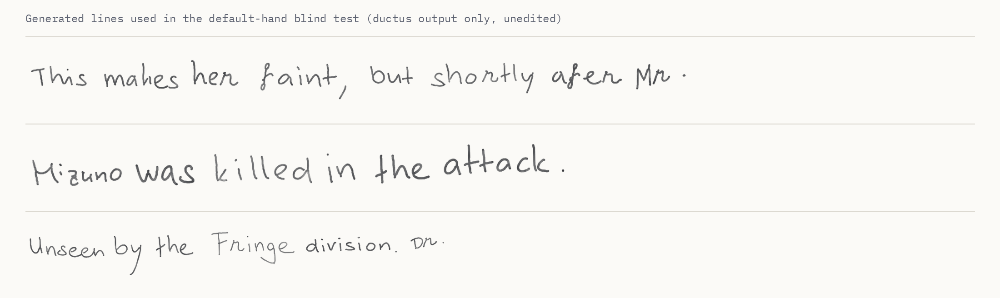

# Blind test: can a classifier tell real handwriting from ductus?

**Short answer: yes, every time so far.** On every run below a simple classifier separates
real lines from ductus lines far better than chance. ductus output is **not** indistinguishable
from real handwriting. These are results, not a pass.

All numbers are in [`benchmark/blind_test.csv`](../benchmark/blind_test.csv). The test is
described in [EVALUATION.md](EVALUATION.md#4-blind-test); this page is the published record of
the runs.

## What 50% means

Windows are balanced half real, half generated, so a classifier that guesses scores 50%. A
score of 50% would mean it cannot find any difference between the two sets; 100% means it
finds one in every window. Lower is better for ductus. A score near 50% only counts if the
classifier is strong enough to find a difference when one exists (see the caveats).

## Method

- **Real lines.** For the IAM runs: lines by writers 173, 204 and 209 from the IAM test set that
  ships with the DiffBrush repository, writers the model was not trained on. 20 lines per writer
  are "real". IAM images are not redistributed here; only scores are.
- **Generated lines.** ductus writes 20 new lines per writer (WikiText sentences, 30 to 50
  characters), 60 lines in all. Run `proxy_v1` copies a style from one reference line per writer;
  `proxy_v3` is the default hand with no style image.
- **Treatment.** Both sets get the same treatment ([`scripts/blind_test.py`](../scripts/blind_test.py)):
  ink extracted from the background, written as dark on white, scaled to 64 px line height, cut
  into 64 x 256 windows that contain ink. The `binarized` variant thresholds both sets so that only
  letter shapes remain and ink texture is gone.
- **Classifiers.** HOG + local-binary-pattern features with logistic regression, and a small CNN.
  5-fold cross-validation grouped by source line, so windows of one line never sit in both train
  and test. Accuracy is the mean over folds; sd is the standard deviation over folds.
- **Scripts.** [`proxy_blind_iam.py`](../scripts/proxy_blind_iam.py),
  [`blind_default.py`](../scripts/blind_default.py), [`blind_test.py`](../scripts/blind_test.py).

## Results

| Run | What it tests | Windows (real / generated) | HOG+LBP logistic | Small CNN |
|---|---|---|---|---|
| `proxy_v1` | 3 IAM writers, flat-ink renderer, style copied from one line | 235 / 235 | 93.6% (sd 3.1) | 90.6% (sd 6.0) |
| `proxy_v1_bin` | same run, binarized | 235 / 235 | 75.5% (sd 3.2) | 62.1% (sd 4.0) |
| `proxy_v3` | 3 IAM writers, default hand (no style image), round 3 engine and ink | 258 / 258 | 98.5% (sd 1.9) | 98.5% (sd 1.6) |
| `proxy_v3_bin` | same run, binarized (letter shape only) | 258 / 258 | 94.6% (sd 1.4) | 91.1% (sd 5.0) |
| `style_matched_r4` | the writer's own profile, 12 real line crops against 12 generated, round 4 engine | 53 / 53 | 100% (sd 0) | 53% (sd 26) |
| `style_matched_r4` binarized | same, binarized | 53 / 53 | 100% (sd 0) | 51% (sd 17) |

`proxy_v1_bin` was scored in the same session as `proxy_v1` and sits in the evaluation
folder, but it was not listed in EVALUATION.md before this page. The style-matched numbers are
the rounded values recorded in EVALUATION.md.

What the rows say:

- **`proxy_v1` to `proxy_v3`.** The earlier run, which copies a style, scores 93.6% and 90.6%.
  The later default-hand run scores 98.5% on both classifiers. That rise is expected: the
  default hand is not trying to look like those writers, so the gap should be larger. It does
  not show the engine got worse.
- **Binarized.** Removing ink texture lowers the score (94.6% and 91.1% on `proxy_v3`), so ink
  is part of the giveaway, but the classifier still wins by a wide margin on letter shapes and
  spacing alone.
- **Style-matched.** The logistic classifier separates the writer's own lines from the generated
  ones perfectly. The CNN, near 50%, is not evidence of realism: with 53 windows per class it has
  too little data to learn anything. See the caveats.

## Caveats

- **Small.** 3 writers and 20 lines each, or 12 lines in the style-matched run. The standard
  deviations are over folds, not over independent samples, and are optimistic.
- **A near-50% score is not a pass.** The style-matched CNN result is a training-size effect,
  not a measure of how human the writing looks.
- **Capture mismatch.** In the style-matched run the real crops come from a phone photo of a
  notebook page and the generated lines from a renderer. A classifier may be using the capture
  difference (paper, lighting, noise) and not the writing. The photo-matched run below is meant
  to remove this.
- **Default hand versus real writers.** `proxy_v3` compares a generic hand with specific
  writers, so a high score there is expected and says little about a profile that is trained
  on the writer.
- **Proxy classifiers, not people.** HOG+LBP and a small CNN are not forensic examiners. A
  person, or a stronger detector, may do better or worse. No tool can promise that a reader
  cannot tell, and handwriting generated to be handed in as one's own work can break the rules
  of a course or workplace whether or not anyone can tell.
- **Reviewer sheets.** [`scripts/blind_test.py`](../scripts/blind_test.py) can also write a shuffled
  24-tile sheet for human or vision-model reviewers. No reviewer results are published yet.
- **Private data.** The writer's photos and crops are not in the repository. Only scores and
  generated images are published.

## Photo-matched run (in progress)

> **In progress. To be filled in by the photo-matched run.** This run puts the generated pages
> through the same phone-photo capture as the writer's real photos and compares line crops
> extracted by the same pipeline on both sides
> ([`scripts/blind_photo.py`](../scripts/blind_photo.py)), so scale, ink extraction and capture
> are the same and only the writing differs. Cue analysis: [`scripts/blind_cues.py`](../scripts/blind_cues.py).

| Item | Result |
|---|---|
| Windows (real / generated) | _pending_ |
| HOG+LBP logistic | _pending_ |
| Small CNN | _pending_ |
| Binarized, logistic / CNN | _pending_ |
| Largest cues found | _pending_ |
| Engine version | _pending_ |

Results will also be added to [`benchmark/blind_test.csv`](../benchmark/blind_test.csv) under a
`photo_matched` run id.
