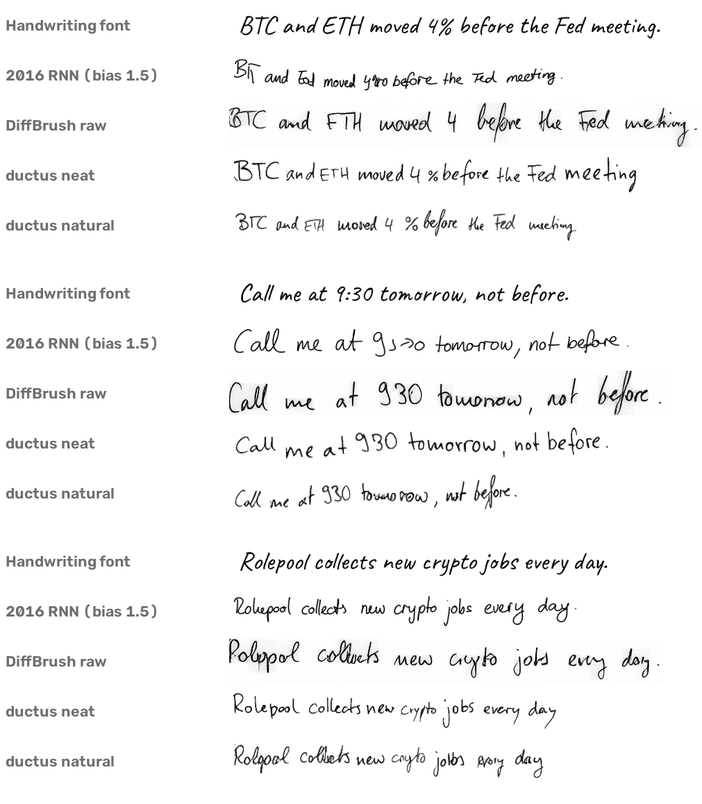

# ductus compared with other tools

This page compares ductus with every alternative that could be run here without a login or a
GPU. Every number comes from the scripts in [`scripts/`](../scripts) and can be reproduced.
Where another tool is better, the table says so.

## Systems

| System | What it is | How it was run |
|---|---|---|
| **2016 RNN** (Graves 2013 / scribe family) | LSTM + mixture density network writing pen strokes | The pretrained [Grzego/handwriting-generation](https://github.com/Grzego/handwriting-generation) checkpoint (MIT), a TensorFlow 1 reimplementation of the same model scribe uses, with built-in style 4 and bias 1.5 (`rnn_b15`) or 2.5 (`rnn_b25`). One sample per line, no seed picking. scribe itself targets TensorFlow 0.x and Python 2 and was not run separately. |
| **Handwriting font** (what most free "text to handwriting" sites do) | A handwriting font typed onto paper | [Caveat](https://fonts.google.com/specimen/Caveat) (OFL), PIL text rendering |
| **DiffBrush raw** (ICCV 2025) | The diffusion model ductus builds on, used directly | Released checkpoint, one sample per line, same preset style, no carriers, no check |
| **ductus** | This project | `neat` look with the `upright` preset; `natural` look with the `quick` preset; and the natural look with the check switched off (`noverify`) |

Not run in this round: SDT (CVPR 2023) is character-level and Chinese-first. One-DM (ECCV 2024)
and DiffusionPen (ECCV 2024) are word-level generators without a page pipeline; running them
on this CPU machine was not attempted yet and is the next comparison to add. Calligrapher.ai
is the same 2013 RNN behind a web page (no API). Emuru (CVPR 2025) failed to load with current
`transformers`. Details in [RESEARCH.md](RESEARCH.md).

## Same input, side by side

The same 40 sentences ([`scripts/data/eval_sentences.txt`](../scripts/data/eval_sentences.txt))
were written by every system: ordinary prose plus names, capitals, digits and symbols
("BTC and ETH moved 4% before the Fed meeting.", "Call me at 9:30 tomorrow, not before.").

## Legibility: OCR character error rate

Judge: `microsoft/trocr-large-handwritten`, a different and larger model than the one ductus
uses for its own check. Normalised CER folds case and spacing around punctuation, which the
judge itself gets wrong on clean text (the font's raw CER is 3.2% for that reason).

RESULTS_CER

Reading the table honestly:

- The font is the most legible. It is also not handwriting: every repeated word is a copy.
- On these 40 lines the 2016 RNN at bias 1.5 and ductus `neat` are level (3.5% vs 3.0 to
  3.2% normalised CER, raw CER 6.3% vs 6.7 to 7.1%). Neither is a clear winner overall.
- They fail on different lines. The RNN writes plain lowercase prose very cleanly and breaks
  on capitals, digits and symbols ("BTC" became "Baer", "9:30" became "9 so"). ductus handles
  those and makes more slips on long lowercase words.
- The read-back check matters: the same pipeline without it (`noverify`) has about five
  times the error.

## Repetition: identical copies of a word

Every pair of occurrences of the same word (same spelling, 3+ letters) in the 40 lines was
compared after scaling to the same height ([`scripts/repetition_probe.py`](../scripts/repetition_probe.py)).

RESULTS_REP

Any generative system avoids identical copies. ductus is not better than the RNN here; both
are at zero. The font is the outlier.

## Style copying

The RNN can only write in the handful of styles it was primed with (pen-trace recordings). ductus
copies a style from one photographed line. The blind test in [EVALUATION.md](EVALUATION.md)
measures how close the copy is, on writers the model never saw.

## Speed (8-core CPU)

| System | Seconds per line |
|---|---|
SPEED_ROWS

ductus is the slowest: about 3.5 s of diffusion per carrier line plus OCR and rewrites. The
RNN is about three times faster per line; the font is instant.

## Features

FEATURE_MATRIX

## Summary

ductus wins on things a page needs: capitals, digits and symbols, maths and notes structures,
style from a photo, corrections, paper types and vector output. It is level with the 2016 RNN
on overall OCR legibility of plain lines, loses to it on clean lowercase prose and on speed,
and a font is more legible than both.
