# ductus guide

How ductus works, how to install it, and every mode and option of version 1.0, each with the
command, what it changes and when to use it. The option tables in [CLI.md](CLI.md) are the
short reference; this page is the long one. Both follow `src/ductus/cli.py`.

Figures on this page were made by [`scripts/make_guide_samples.py`](../scripts/make_guide_samples.py)
with the public default style, the same input text in every row, and a fixed seed. Times are
from a shared 8-core CPU without a GPU.

## Contents

1. [How it works](#1-how-it-works)
2. [Install](#2-install)
3. [Quick start](#3-quick-start)
4. [Content modes: plain, notes, maths](#4-content-modes)
5. [Engines: which model writes the letters](#5-engines)
6. [Read-back: the OCR check](#6-read-back)
7. [Speed: fast, budget, word bank, cache](#7-speed)
8. [Letter shapes: glyphs, loops, RNN style](#8-letter-shapes)
9. [Styles and looks](#9-styles-and-looks)
10. [Pens, ink and paper](#10-pens-ink-and-paper)
11. [Borders and margin lines](#11-borders-and-margin-lines)
12. [Phone photo](#12-phone-photo)
13. [Your own hand: style and charset](#13-your-own-hand)
14. [Output files](#14-output-files)
15. [GPU, threads and other environment variables](#15-gpu-threads-and-environment-variables)
16. [Python API](#16-python-api)
17. [Recipes](#17-recipes)
18. [Troubleshooting](#18-troubleshooting)
19. [Known limits](#19-known-limits)

## 1. How it works

<picture>
  <source media="(prefers-color-scheme: dark)" srcset="diagrams/architecture-dark.svg">
  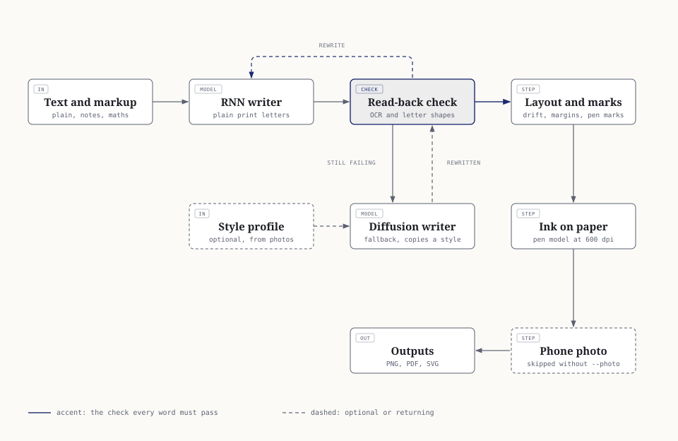
</picture>

A page is made in six steps.

1. **Parse.** The markup (`# Heading`, `Term :: meaning`, `{a/b}`, `[v]` ...) becomes notebook
   blocks: headings, definitions, lists, tables, maths lines.
2. **Write.** All words are packed into ordinary carrier sentences of about 46 characters,
   because line models write whole lines best. The Graves handwriting RNN writes the carriers
   in batches, and each line is cut back into words. Numbers, symbols and capital-only tokens
   are drawn from templates instead.
3. **Read back.** Every word is read by OCR and its letter shapes are checked. Words that do not
   read are written again in new carriers (section 6).
4. **Fall back.** Words the RNN cannot write, or that still fail after its rounds, go to
   DiffBrush, a one-shot diffusion model. A word that fails every round is used anyway and
   counted in `still_failing`.
5. **Lay out.** Words are placed with human variation in baseline, size, slant and spacing;
   arrows, ticks, rules and borders are drawn as pen strokes.
6. **Render.** The ink model draws the page at 600 dpi on white, ruled or grid paper. With
   `--photo` a camera model then photographs it.

Module-level detail is in [ARCHITECTURE.md](ARCHITECTURE.md) and the method in
[METHOD.md](METHOD.md).

## 2. Install

```bash
git clone https://github.com/PrafullJ0shi/ductus && cd ductus
python -m venv .venv && . .venv/bin/activate
pip install -e ".[model,pdf]"        # Python 3.10 or newer
pip install onnxruntime              # optional: faster OCR read-back on a CPU
```

The default writer is the Graves RNN. It needs the pretrained checkout and, once, a Python with
TensorFlow 2 to export its weights:

```bash
git clone https://github.com/Grzego/handwriting-generation ~/.cache/ductus/handwriting-generation
export DUCTUS_RNN_PYTHON=/path/to/python-with-tensorflow
```

The first run downloads the DiffBrush checkpoint (1.2 GB), the Stable Diffusion 1.5 VAE and
TrOCR from public links. No account is needed. After that ductus works offline and does not
upload your text or photos. Without the RNN, ductus writes every word with diffusion: it
still works, but it is slower and reads worse.

Check the install:

```bash
ductus --help
ductus presets          # lists upright, slant, quick, round, loose
```

## 3. Quick start

```bash
ductus write --text "Hello from ductus" -o out/hello
ductus write examples/definitions.txt -o out/defs --mode notes
ductus write examples/maths.txt -o out/maths --mode maths --fast
```

Each command writes `out/NAME.png` and `out/NAME.pdf` (A4, 300 dpi) and prints one JSON line
of statistics, for example:

```json
{"files": ["out/notes.png"], "lines_generated": 22, "still_failing": 1, "words": 27, "seconds": 50.4, "pages": 1, "ocr_mean_score": 0.994, "pen_px": 4.49, "max_cer": 0.1, "pen": "blue-ballpoint"}
```

That line is from a real 27-word notes page. `still_failing: 1` means one word (`carbon`) did
not pass the read-back after every round and was used as written. Progress messages
(`word bank: 4 words taken`, `round 1 (rnn): 21 words in 4 lines` ...) go to stderr; `-q`
hides them.

Input is a text file, `-` for stdin, or `--text "..."` inline. Longer text flows onto more
pages: `NAME-1.png`, `NAME-2.png` and one `NAME.pdf`.

## 4. Content modes

`--mode` decides which markup is understood and how blocks are laid out.

| Mode | Command | Use it for |
|---|---|---|
| `plain` (default) | `ductus write letter.txt -o out/letter` | prose, letters, anything without markup |
| `notes` | `ductus write notes.txt -o out/notes --mode notes` | class notes: headings, `Term :: meaning`, lists, ticks, corrections |
| `maths` | `ductus write sums.txt -o out/sums --mode maths` | worked steps, fractions, roots, powers, tables of values |

| Notes mode | Maths mode |
|---|---|
| 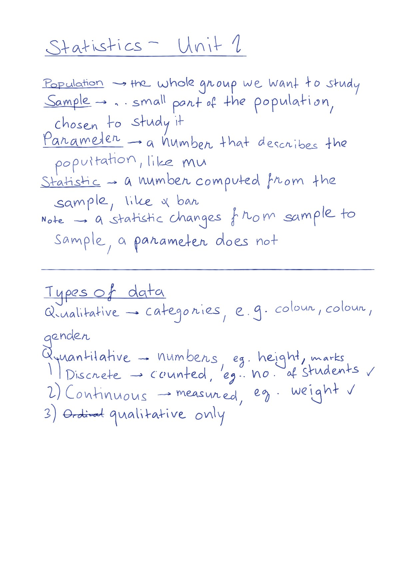 | 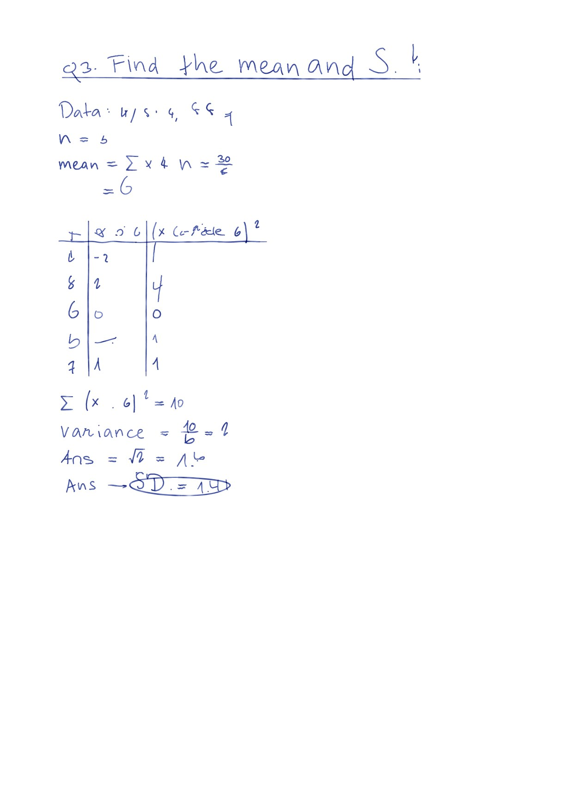 |

The markup, in short. The full table is in [CLI.md](CLI.md#markup).

```text
# Heading                      ## Sub heading            ---   (separator)
Term :: meaning                Note: text                1) item   - item
| a | b |  (table row)         = expr  (aligned under the = above)
->  <-  =>   [v] [x]   ~~struck~~   __underlined__   ((circled))
{a/b}  sqrt(x)  {sum}  x^2   {oops:word}  (written, then crossed out)
```

`=`, `<`, `>`, `%` and `~` are drawn as pen marks. Characters with no glyph and no mark become a
close ASCII form (`@` becomes `at`).

## 5. Engines

`--engine` chooses which model writes the letters.

| Value | What happens | When to use it |
|---|---|---|
| `default` | RNN letters when the RNN is installed, diffusion for words the RNN cannot write or that keep failing; diffusion only when the RNN is missing | almost always |
| `rnn` | same as `default`, but stops with an error if the RNN is missing | scripts that must not fall back silently |
| `diffusion` | DiffBrush writes every word, copying letter shapes from `--style` | copying letter shapes from a reference image or profile |
| `auto` | diffusion first, the RNN for words that do not read | a personal style where shape matters but every word must still read |

```bash
ductus write notes.txt -o out/n --engine rnn
ductus write notes.txt -o out/n --engine diffusion --style styles/my-hand --steps 25
```

`--steps N` (default `25`) is the number of diffusion steps; fewer is faster and rougher. It has
no effect on RNN words. Diffusion is much slower on a CPU: round 1 of the benchmark, which used
diffusion for every word, took 390 s per line ([BENCHMARK.md](BENCHMARK.md)).

## 6. Read-back

<picture>
  <source media="(prefers-color-scheme: dark)" srcset="diagrams/readback-dark.svg">
  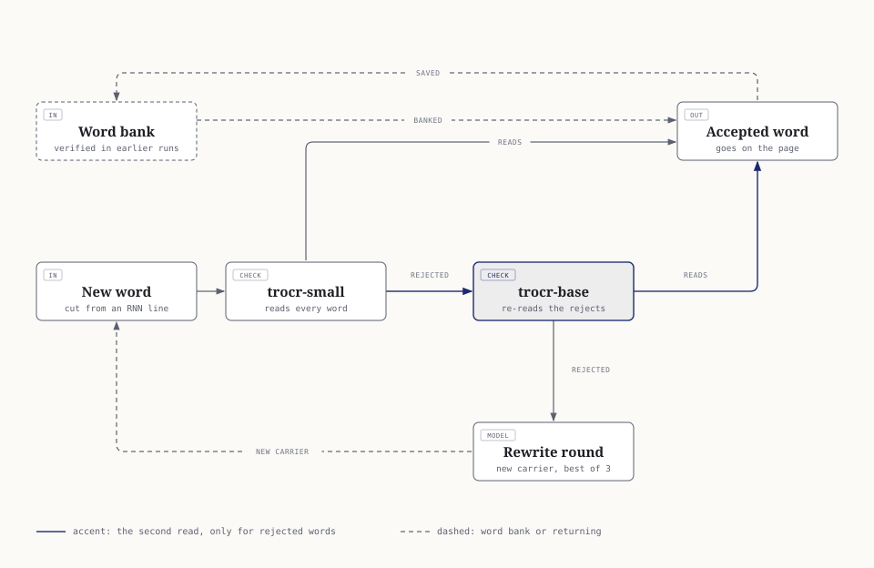
</picture>

Every word is read back and compared with what it should say. A word is accepted when its
character error rate is at most `--max-cer`; otherwise it is written again in a new carrier
line. In the late rounds each stubborn word gets three candidates and the best one is kept
(`DUCTUS_BEST_OF`).

| Option | Default | What it does | When to change it |
|---|---|---|---|
| `--ocr cascade` | on | `trocr-small` reads every word; `trocr-base` re-reads only the words small rejects | keep it |
| `--ocr base` | | `trocr-base` reads every word (the 0.x behaviour; slower) | to compare with old results |
| `--ocr small` | | `trocr-small` only, no re-read | drafts; `--fast` sets this |
| `--legibility strict` | on | every word must pass both the line read and the word read | keep it for readable pages |
| `--legibility loose` | | only clearly wrong or missing words are caught | personal hands with unusual letters |
| `--max-cer X` | `0.10` | acceptance threshold; `0.15` with `--look neat`; with `loose` and a profile, the profile's value (0.5 by default) | lower for stricter pages, higher for faster ones |
| `--no-verify` | off | no read-back at all | fastest preview; expect wrong words |

On a CPU the image encoder of the OCR runs in ONNX Runtime when `onnxruntime` is installed
(1.6 to 1.8 times faster reads in our test, same results on 16 of 16 test words).
`DUCTUS_ONNX=0` turns that off.

## 7. Speed

Measured in [round 7 of the benchmark](BENCHMARK.md#round-7-more-speed-ideas-measured-one-by-one),
same 84-word page, shared 8-core CPU:

| Run | Time | What changed |
|---|---|---|
| default, new words | 84 s | cascade read-back, up to 8 RNN rounds, diffusion fallback |
| `--fast`, new words | 36 s | `--ocr small`, 4 rewrite rounds, no diffusion fallback; 3 of 84 words rougher |
| default, words already in the bank | 22 s | most words taken from the word bank |

These are examples from one machine, not promises. Load on the machine changes them a lot.

**`--fast`**: draft speed. Use it while you edit the text; drop it for the final page.

```bash
ductus write notes.txt -o out/draft --mode notes --fast
```

**`--budget S`**: after S seconds no new rewrite round starts. Words still failing keep their best
attempt. Use it when you need a page by a deadline.

```bash
ductus write notes.txt -o out/page --budget 45
```

**Word bank** (on in the CLI, off in the Python API). Words that passed the read-back are saved
under `~/.cache/ductus/bank`, keyed by engine, style and read-back settings, and later pages take
them instead of writing them again. A saved word is used at most once per document, warped
slightly each time (width, height, shear), and dropped after 3 documents, so pages do not repeat
an image. `--no-bank` turns it off. `scripts/build_bank.py` fills the bank from a word list.

```bash
ductus write notes.txt -o out/page --no-bank
```

**Word cache** (on by default; `--no-cache` turns it off). This is different from the bank: the
exact words generated for one text with one set of writing options are kept under
`~/.cache/ductus/words`. Changing only the pen, tip, ink, paper, photo, border or ink model then
re-renders the page in seconds without writing the words again. Changing the text, look, seed,
style, engine or read-back settings writes the words afresh. The pen and paper figures below
were made this way: the same words, rendered differently.

## 8. Letter shapes

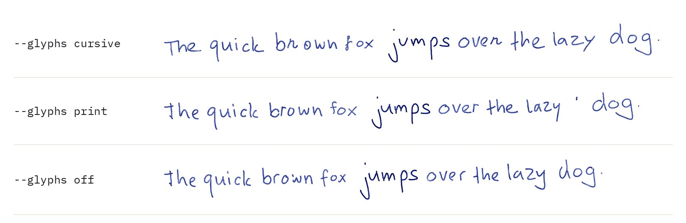

| Option | Default | What it does |
|---|---|---|
| `--glyphs cursive` | on | `r` and `f` drawn as a school-cursive `r` and a looped `f` |
| `--glyphs print` | | plain print `r` and `f` |
| `--glyphs off` | | `r` and `f` as the RNN writes them |
| `--allow-loops` | off | keep looped `f`, stylish `r` and looped ascenders from the model; by default such words are written again until the plain form appears |
| `--rnn-style N` | `1` | built-in RNN writer, 0 to 7; style 1 writes plain print letters |
| `--rnn-bias B` | `1.5` | RNN neatness; higher is neater and more uniform |

```bash
ductus write notes.txt -o out/print --glyphs print
ductus write notes.txt -o out/rnn3 --rnn-style 3 --rnn-bias 1.2
```

With `--glyphs cursive` the default runs up to 8 RNN rounds before the diffusion fallback; with
`print` or `off`, 4. In the figure, the `print` row has a stray mark left of `dog`; see
[troubleshooting](#18-troubleshooting).

## 9. Styles and looks

**`--style`** sets the reference hand: a preset name, a line image, or a profile folder from
`ductus style`. With the default RNN engine it changes size and spacing; letter shapes are copied
only with `--engine diffusion` or `auto`.

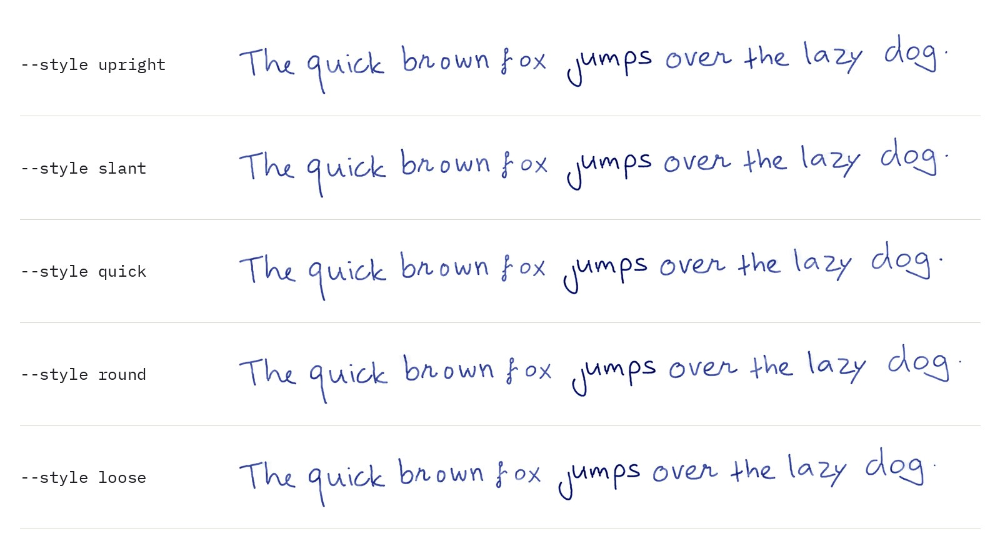

| Preset | Note (from `ductus presets`) |
|---|---|
| `upright` (default) | upright, open, evenly spaced |
| `slant` | right-leaning, joined, compact |
| `quick` | fast everyday hand |
| `round` | wide and round, airy spacing |
| `loose` | loose loops, uneven size |

**`--look`** sets how much human variation is added on top.

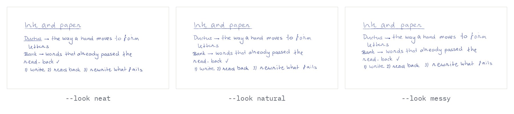

| Look | What it does | When to use it |
|---|---|---|
| `neat` | little drift, no human-error pass | handouts, anything that must look tidy |
| `natural` (default) | ordinary drift in baseline, size and slant | most pages |
| `messy` | more drift, and 3% of words written wrong, struck out and rewritten | rushed lecture notes |
| `profile` | the measured habits of a personal `--style` profile | your own hand (section 13) |

Fine control:

| Option | Default | What it does |
|---|---|---|
| `--size MM` | `2.8` | x-height of the writing in mm |
| `--humanize RATE` | `0.5` | rate of the human-error pass (drift, retouched letters); `0` turns it off; ignored with `--look neat` |
| `--corrections RATE` | by look | share of words written wrong, struck out and rewritten (`messy` 0.03, others 0) |
| `--seed N` | `0` | same input, options and seed give the same page (see the note on the bank in section 18) |

## 10. Pens, ink and paper

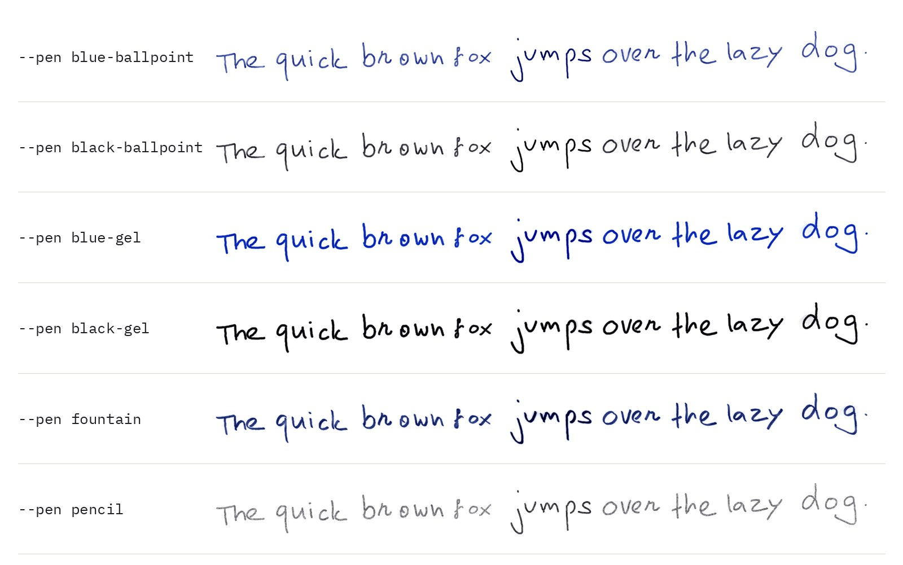

| Option | Default | Values |
|---|---|---|
| `--pen` | `blue-ballpoint` | `blue-ballpoint`, `black-ballpoint`, `blue-gel`, `black-gel`, `fountain`, `pencil` |
| `--tip MM` | pen's own | `0.5`, `0.7`, `1.0` (other numbers are accepted) |
| `--weight W` | `1.0` | stroke weight multiplier on top of the pen |
| `--ink '#rrggbb'` | pen's colour | any ink colour |
| `--ink-model` | `realism` | `realism` (striations, skips, blobs, darker overlaps), `pens` (simpler), `flat` |
| `--flat-ink` | off | same as `--ink-model flat`, for comparison |

```bash
ductus write notes.txt -o out/gel --pen black-gel --tip 0.7
ductus write notes.txt -o out/red --ink '#9b1c1c' --weight 1.2
```

Numbers for each pen are in [PENS.md](PENS.md) and the ink method in [INK.md](INK.md).

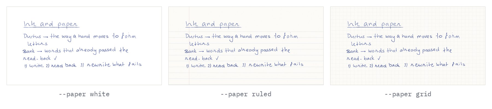

`--paper white` (default), `ruled` or `grid`. Grid is the default with `--photo notebook`. The
writing follows its own baseline, not the printed lines.

## 11. Borders and margin lines

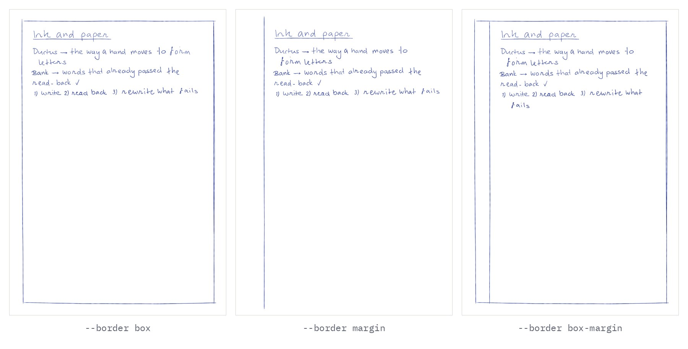

| Option | Default | What it does |
|---|---|---|
| `--border` | `none` | `box` (ruled box), `margin` (left margin line), `box-margin` (both), like a project file |
| `--border-inset MM` | `12` | distance of the box from the paper edge; each side is a little different on every page |
| `--border-header MM` | `0` | also rule a line this far from the top, under a heading area (`0` = none) |

```bash
ductus write report.txt -o out/file --mode notes --border box-margin --border-header 40
```

Borders are drawn in the pen's ink, slightly uneven, and the text stays inside them, so a page
holds fewer words. Details in [PAGES.md](PAGES.md).

## 12. Phone photo

Without `--photo` the output is a clean scan-like page. With it, a camera model photographs the
page: perspective, light falloff, shadow, white balance, defocus, sensor noise, sharpening and
JPEG, with parameters measured from a real phone photo.

| Value | What it looks like |
|---|---|
| `--photo` or `--photo a4` | one loose white A4 sheet on a desk, a corner lifted slightly, soft contact shadow |
| `--photo notebook` | spiral-bound grid pad, pages below, curl at the binding |

```bash
ductus write notes.txt -o out/photo --photo
ductus write notes.txt -o out/pad --photo notebook --pen black-gel
```

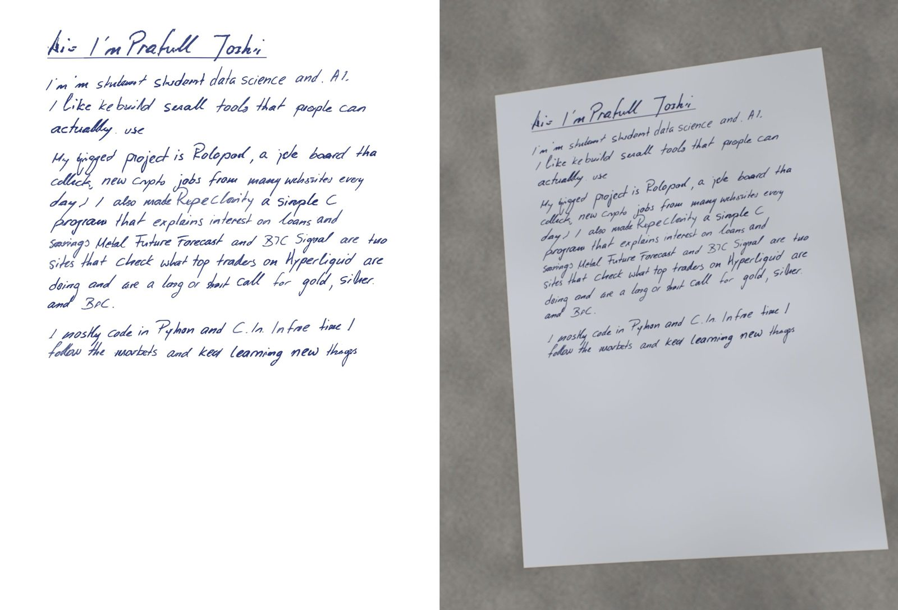

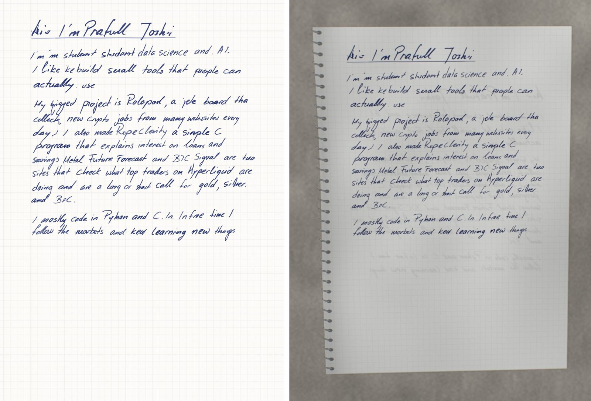

Sources for every realism detail are in [REALISM.md](REALISM.md).

## 13. Your own hand

Build a profile from photos of pages you wrote, then write with it:

```bash
ductus style page1.jpg page2.jpg page3.jpg -o styles/my-hand [--name my-hand] [--no-ocr]
ductus charset charset.jpg --style styles/my-hand
ductus write notes.txt -o out/mine --style styles/my-hand --look profile --mode notes
```

- `ductus style` measures size, spacing, slant, ink colour and habits and saves
  `styles/my-hand/profile.json`, reference line crops and cleaned ink maps. `--no-ocr` skips the
  check that finds upside-down pages.
- `ductus charset` traces your capitals, digits and symbols from one photo of a character sheet
  (rows: `a-n`, `o-z`, `A-P`, `Q-Z`, `0-9`, then symbols) into `glyphs.json` in the profile. They
  are used for template capitals, digits and symbols, not yet for lowercase letters in words.
- With the default engine the letters stay the plain RNN hand; the profile sets everything
  else. Add `--engine auto` or `--engine diffusion` to copy letter shapes too, at a cost in
  speed and readability.

Profiles are personal data. `styles/` is ignored by git; keep it that way. Write only your own
hand or one you have permission to use. More in [STYLE_GUIDE.md](STYLE_GUIDE.md) and
[HABITS.md](HABITS.md).

## 14. Output files

| Option | Writes |
|---|---|
| (always) | `OUT.png`, or `OUT-1.png`, `OUT-2.png` ... for several pages |
| (default) | `OUT.pdf` with every page; `--no-pdf` skips it |
| `--svg` | `OUT.svg`: traced outlines for words, strokes for marks |
| `--animate` | `OUT.anim.svg`: the page writes itself word by word |
| `-q` | nothing extra; hides progress messages |

## 15. GPU, threads and environment variables

ductus runs on a CPU. When PyTorch sees a CUDA or Apple (MPS) GPU, the OCR, the RNN sampler and
the diffusion fallback use it automatically. That path has not been timed; there are no GPU
numbers in this repository.

| Variable | Meaning |
|---|---|
| `DUCTUS_DEVICE` | `cpu`, `cuda` or `mps`; overrides the automatic choice |
| `DUCTUS_THREADS` | CPU threads for the models; default: the cores free when ductus starts, at most 8 |
| `DUCTUS_RNN_THREADS` | at most this many threads for the RNN (default 2) |
| `DUCTUS_RNN_BATCH` | lines the RNN samples together (default 8) |
| `DUCTUS_RNN_BACKEND` | `torch` (batched PyTorch sampler, default) or `worker` (old TensorFlow process) |
| `DUCTUS_RNN_DIR`, `DUCTUS_RNN_PYTHON` | RNN checkout and the Python with TensorFlow 2 |
| `DUCTUS_ONNX` | `0` runs the OCR encoder in PyTorch instead of ONNX Runtime |
| `DUCTUS_BEST_OF` | candidates per stubborn word in the late rounds (default 3) |
| `DUCTUS_SKIP_READS` | `0` reads every word crop, even where the read cannot change the verdict |
| `DUCTUS_CACHE` | folder for weights, the word cache and the bank (default `~/.cache/ductus`) |

On a busy machine fewer threads can be faster: one RNN step took 85 ms with 4 threads and 2 ms
with one on an 8-core box at load 20 (`src/ductus/speed.py`).

## 16. Python API

```python
from ductus.page import Writer, Options
from ductus.render import save_pdf, save_svg
import cv2

w = Writer()                                   # loads the models once; reuse it
o = Options(mode="notes", look="natural", pen="black-gel", border="margin", seed=3, bank=True)
r = w.write(open("notes.txt").read(), o)
cv2.imwrite("page.png", r.pages[0][..., ::-1])
save_svg(r.layouts[0], r.words, "page.svg", r.look.ink, r.stats["pen_px"], animate=True)
print(r.stats)
```

Differences from the CLI:

- The word bank is **off** by default (`bank=False`); the CLI turns it on.
- Option names are the CLI flags with underscores: `border_inset`, `ink_model`, `rnn_style`.
  `--no-verify` is `verify=False`, `--no-cache` is `cache=False`, `--allow-loops` is `plain=""`.
- One `Writer` keeps the models loaded, so many pages in one process are much faster than many
  CLI calls.

`write_lines(writer, lines, options)` returns one tight grayscale crop per input line; the
evaluation scripts use it.

## 17. Recipes

```bash
# lecture notes on a spiral pad, rushed
ductus write notes.txt -o out/lecture --mode notes --look messy --photo notebook

# project-file page with box, margin and heading line, black gel
ductus write report.txt -o out/file --mode notes --border box-margin --border-header 40 --pen black-gel

# worked maths on grid paper
ductus write sums.txt -o out/sums --mode maths --paper grid

# quick draft while editing the text
ductus write notes.txt -o out/draft --mode notes --fast

# same page, new pen only (words come from the word cache)
ductus write notes.txt -o out/fountain --mode notes --pen fountain

# from another program
echo "Meeting at 4 -> room 2 [v]" | ductus write - -o out/memo --mode notes
```

## 18. Troubleshooting

**"RNN model not found".** Check `~/.cache/ductus/handwriting-generation/pretrained/model-29.meta`
or set `DUCTUS_RNN_DIR`, and set `DUCTUS_RNN_PYTHON`. With `--engine default` ductus falls back to
diffusion for every word; with `--engine rnn` it stops.

**A word still looks wrong.** Look at `still_failing` in the JSON line. Try another `--seed`,
`--look neat`, or a lower `--max-cer`. The OCR judge also misreads drawn marks, so a correct
maths line can still be rejected.

**A small stray mark next to a word.** A known loose end, seen next to a cursive `f` and once
before `dog` with `--glyphs print`. Another `--seed` usually removes it.

**The same seed gave a different page.** With the word bank on, which saved variants are taken
changes from run to run. Use `--no-bank` for pages that must be identical.

**It is slow.** See section 7: `--fast`, `--budget`, the bank, `pip install onnxruntime`, and
`DUCTUS_THREADS` on a busy machine. The first run also downloads about 3 GB of models.

**Notes markup is printed literally.** Add `--mode notes` or `--mode maths`; `plain` ignores
markup.

**The text runs onto a second page.** Borders, a larger `--size` and `--border-header` all
reduce room. Each page is saved as `OUT-N.png`.

**`accelerate` warning when the diffusion fallback loads.** Harmless. `pip install accelerate`
removes it.

## 19. Known limits

- **It does not pass a blind test.** Classifiers still tell real handwriting from ductus pages:
  in the writer's own profile, logistic regression 91.3%, a small CNN 69.9% and a fine-tuned
  ResNet-18 98.5%, measured on only 3 real pages ([BLIND_TEST.md](BLIND_TEST.md)). It is not
  undetectable and should not be described that way.
- Readability is good but not perfect: normalised CER 0.038 on the 4 main test lines, maths the
  weakest (0.15). The tests are small (7 lines, one sample each).
- Slow on a CPU compared with fonts; GPU timings are not measured.
- ASCII only. Accented letters and currency signs are not written.
- Maths is the markup above, not a LaTeX renderer.
- With the default engine, a profile does not copy your letter shapes.
- Loose ends (occasional `l`/`t` look-alikes, stray marks) are listed in
  [ROADMAP_V2.md](ROADMAP_V2.md).

Write your own hand or one you have permission to use. Do not imitate signatures or hand in
generated pages as someone else's work.
