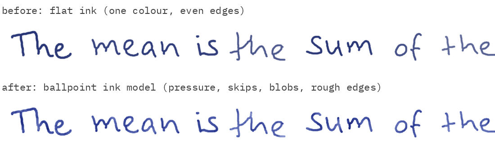

# Pens and the ink model

Generated handwriting usually gives itself away in the ink before the letters: one flat
colour, perfect anti-aliased edges, the same density everywhere. ductus renders the *path of
the pen* first and then lets a pen deposit ink along it.

## Pens

| `--pen` | Ink | Line on paper (default tip) | Behaviour |
|---|---|---|---|
| `blue-ballpoint` (default) | `#2c3a86` | 0.38 mm | lighter on fast straight strokes, small blobs at ends and turns, faint skips |
| `black-ballpoint` | `#2a2a30` | 0.38 mm | as above |
| `blue-gel` | `#1f3fc4` | 0.46 mm | dense, even, little speed effect, no skips, more bleed |
| `black-gel` | `#141418` | 0.46 mm | as above |
| `fountain` | `#2a3a7e` | 0.42 mm | italic-like nib: line width follows stroke direction; ink pools at ends and dries darker at the edges |
| `pencil` | `#55565c` | 0.42 mm | lighter, graphite catches only the paper tooth (grain), no blobs |

`--tip 0.5`, `--tip 0.7` or `--tip 1.0` sets the nominal tip size, which maps to a line
width of 0.30, 0.38 or 0.50 mm (gel and fountain about 20% wider). `--ink` overrides the
colour and `--weight` scales the line on top of the pen. With a personal profile, the
default pen uses the **measured** ink colour and line width from the photos.

`--flat-ink` keeps the old flat model for comparison.

## Method

1. **Stroke shape.** Every generated word is skeletonised (its centre line) at 600 dpi and
   re-inked at the pen's line width: a disc for ballpoint, gel and pencil, a rotated thin
   ellipse (the nib) for the fountain pen. This also makes every word on a page share one
   stroke weight, whatever line of the generator it came from. Pen marks (arrows, ticks,
   rules) are drawn at the same width.
2. **Overlap count.** The renderer counts how many strokes pass over each point, so a
   strike-through over a word or a retraced letter carries twice the ink.
3. **Concentration.** `pens.concentration` turns shape and count into ink concentration:
   - *speed*: pen speed falls in tight curves (two-thirds power law). A structure-tensor
     coherence map marks straight stretches as fast (less ink) and turns as slow (more ink);
   - *blobs*: centre-line end points and junctions get extra ink (ballpoint "gooping");
   - *skips*: on fast stretches a ballpoint briefly runs dry, shown as short faint streaks;
   - *pressure*: a slow random field along the line, plus a page-level pressure field;
   - *edges*: fine noise on the stroke boundary so no edge is vector-perfect;
   - *pencil grain*: two-octave paper-tooth noise;
   - *fountain*: a darker rim where wet ink dries, more pooling at slow points;
   - *bleed*: a per-pen wicking blur;
   - *smudges*: a few short directional smears where the hand dragged fresh ink.
4. **Colour.** Beer-Lambert: transmittance = (colour of one stroke) ^ concentration,
   multiplied onto the paper. Overlaps and blobs get darker and slightly more saturated, the
   way layered ink does, without any extra rule.
5. **Resolution.** Everything above runs at 600 dpi and is downsampled to the 300 dpi A4
   output. The SVG output keeps vector outlines; the raster output is the realistic one.

## Before and after at 100%

A comparison with the user's own ink (crops from his photos) is produced on his machine by
`scripts/ink_compare.py`; his photos are not part of the repository.

## Sources

- Ballpoint line features (striations, gooping, skipping):
  [Norwitch Document Laboratory](https://www.questioneddocuments.com/individual-characteristics/),
  [Northwestern JCLC](https://scholarlycommons.law.northwestern.edu/cgi/viewcontent.cgi?article=4544&context=jclc).
- Speed and curvature: [Lacquaniti, Terzuolo and Viviani, 1983](https://doi.org/10.1016/0001-6918(83)90027-6).
- More details and status in [REALISM.md](REALISM.md).
