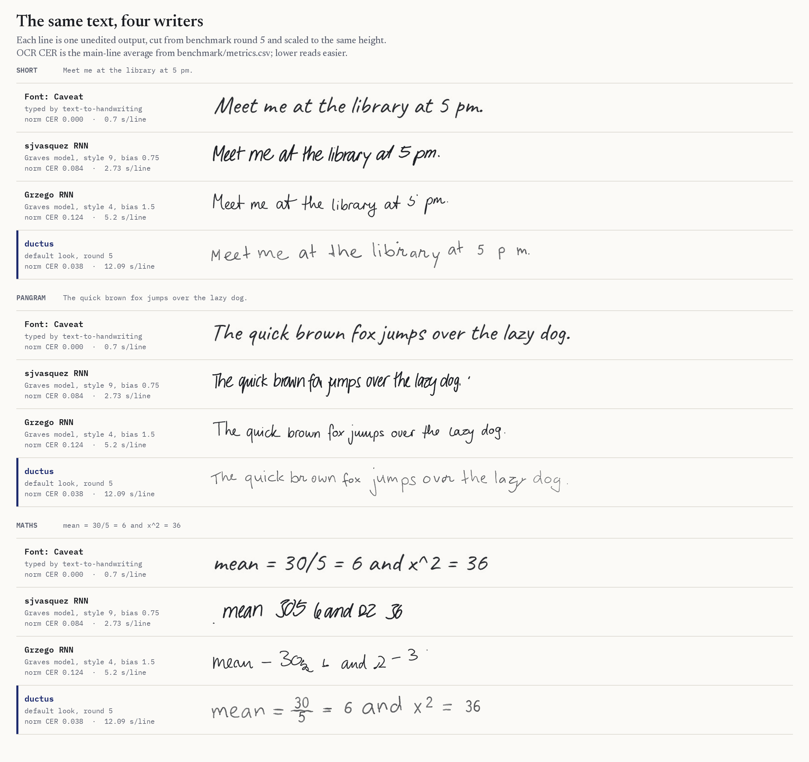

# Versus: the same text from a font, two RNNs and ductus



Same input text for every row. Each image is one output, cut from the round 5 benchmark
page or line renders and scaled to the same height, with nothing retouched. The figure is
built by [`docs/diagrams/build_versus.py`](diagrams/build_versus.py) from the benchmark
outputs, and the numbers in its captions are read from
[`benchmark/metrics.csv`](../benchmark/metrics.csv).

| Row | What it is | How it was run |
|---|---|---|
| Font: Caveat | a handwriting font typed onto paper by [text-to-handwriting](https://github.com/saurabhdaware/text-to-handwriting) | web app, font Caveat, no effect, very high resolution |
| sjvasquez RNN | [sjvasquez/handwriting-synthesis](https://github.com/sjvasquez/handwriting-synthesis), a Graves 2013 model | style 9, bias 0.75, ported to TensorFlow 2 for the test |
| Grzego RNN | [Grzego/handwriting-generation](https://github.com/Grzego/handwriting-generation), a Graves 2013 model | pretrained `model-29`, style 4, bias 1.5 |
| ductus | this project, default look (round 5 engine, `--look natural`, seed 0) | `ductus write` on one A4 page of the 7 test lines, cut into lines |

The ductus maths line is given in its own markup (`mean = {30/5} = 6 and x^2 = 36`), the
others get the plain text; see [BENCHMARK.md](BENCHMARK.md#test-texts). The source engine has
not changed since round 5 (the later commits only add evaluation scripts), so these are the
current default's outputs. They were not re-rendered for this page.

## Numbers

Readability is OCR character error rate (CER) from `microsoft/trocr-large-handwritten`, the
same judge for every system. Lower is easier to read. "Main" is the average over four lines
(short, definition, maths, pangram); the last three test columns are single lines. Everything
comes from [`benchmark/metrics.csv`](../benchmark/metrics.csv); methods are in
[BENCHMARK.md](BENCHMARK.md#method).

| System | norm CER, main | maths | digits | symbols (raw) | capitals | repeated glyphs | s per line |
|---|---|---|---|---|---|---|---|
| Font: Caveat | **0.000** | **0.000** | 0.037 | 0.478 | **0.000** | 0.462 | **0.7** |
| sjvasquez RNN | 0.084 | 0.200 | 0.482 | 0.783 | 1.500 | **0.000** | 2.73 |
| Grzego RNN | 0.124 | 0.300 | 0.111 | 0.826 | 0.591 | **0.000** | 5.2 |
| ductus, round 5 | 0.038 | 0.150 | 0.037 | 0.435 | **0.000** | **0.000** | 12.09 |

- **Digits** and **capitals** are normalised CER (lowercase, `a-z 0-9` only); **symbols** is raw
  CER because the normalised reference is empty.
- **Repeated glyphs** is the share of ink shapes that have a near-identical twin elsewhere in
  the output (cross-correlation 0.95 or more, same size). A font reuses one image per letter,
  so it shows up; the generators do not repeat.
- **s per line** is as logged on a shared 8-core CPU with no GPU. The ductus figure is for a
  warm cache on a lightly loaded machine (load 1 to 4); the same benchmark ran at 390 s per line in round 1 on a heavily
  loaded machine and 38 s in round 3. A cold run of 243 words took about 10 minutes, so
  budget a few minutes per page ([EVALUATION.md](EVALUATION.md#3-speed)). The font numbers are a
  browser render.
- n = 7 lines, one sample per system. One bad word moves a line by 10 to 15 points, so
  differences of a few hundredths are noise.

## Where each one wins and loses

**Font (Caveat).** Easiest to read and by far the fastest, and every symbol and capital
exists. It loses on looking like a person: it reuses one image per letter, so 46% of ink
shapes have a twin, and a reader or detector sees that straight away.

**sjvasquez RNN.** Good short-line readability (0.084) at under 3 seconds a line, and the one baseline
close to ductus on the main lines. It has no Q, X or Z, and its capitals (1.500) and digits
(0.482) are read badly. It has no page layout or maths. It ships no licence file.

**Grzego RNN.** The same family of model with a plainer hand. It
writes digits better than sjvasquez but misses many capitals (0.591) and symbols, and does
not handle maths. Lines are single strips; there is no page layout.

**ductus.** Best readability of the three generators on these lines (0.038), digits level
with the fonts, capitals clean, a stacked fraction and a real superscript, and an A4 page
with a pen, ink and photo model. It loses on speed (12 s a line warm, minutes a page cold),
on the maths line (0.150, the judge still misreads the drawn `=`), on symbols (0.435: the judge reads `% + ; :`
as `#` or drops them) and on small letter slips, visible in the figure: the short line spaces
"p m" apart and "5" and "p" are not joined, and in the pangram "brown" is split. It does not
beat a font on readability. It is also not shown to be indistinguishable from a real hand;
see [BLIND_TEST.md](BLIND_TEST.md).

## Reproduce

```
python docs/diagrams/build_versus.py BENCHMARK_OUT docs/assets/versus.png
```

`BENCHMARK_OUT` holds one folder per system with `lines/000.png` onwards in the order of
[`benchmark/texts/tests.tsv`](../benchmark/texts/tests.tsv). The scores come from
`benchmark/scripts/ocr_score.py` and `benchmark/scripts/glyph_repetition.py`.
