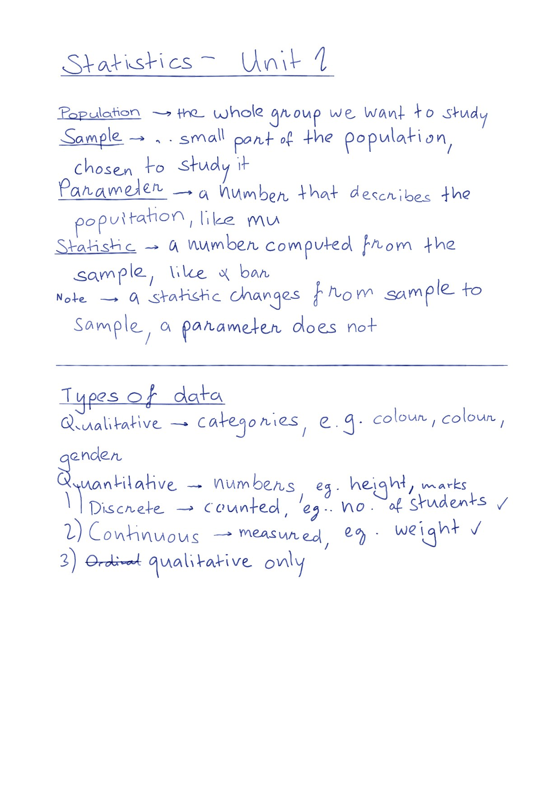
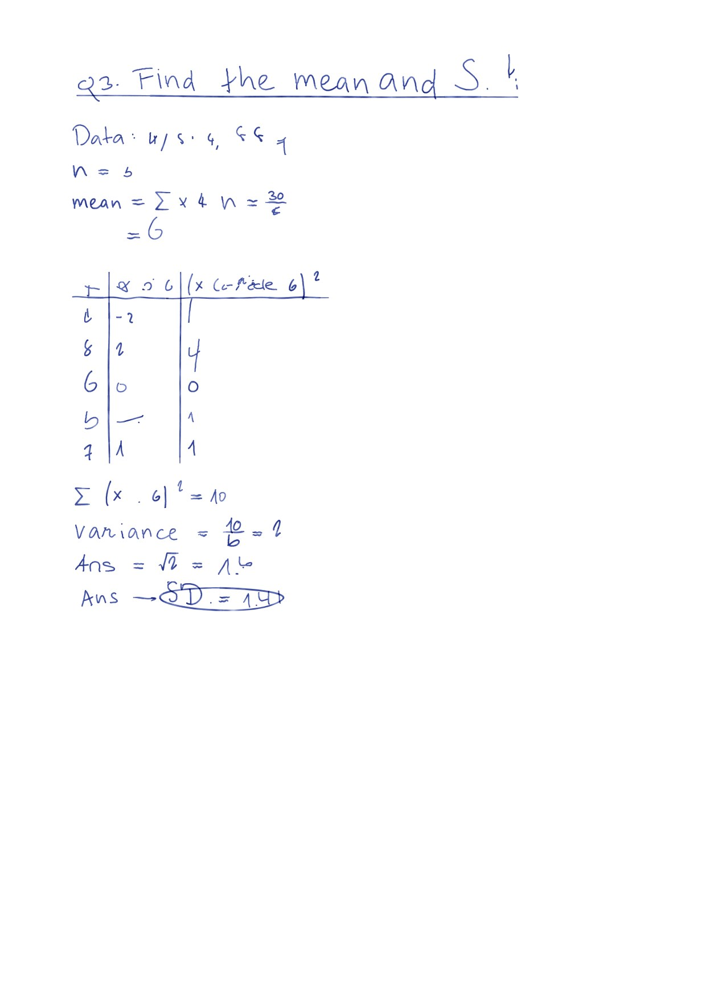
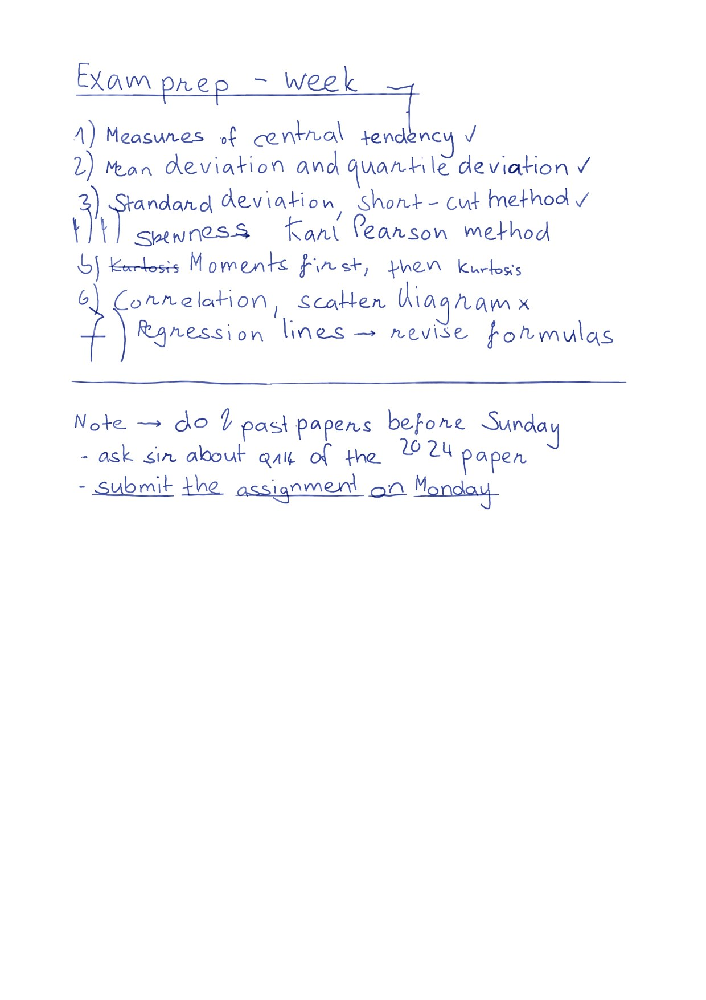
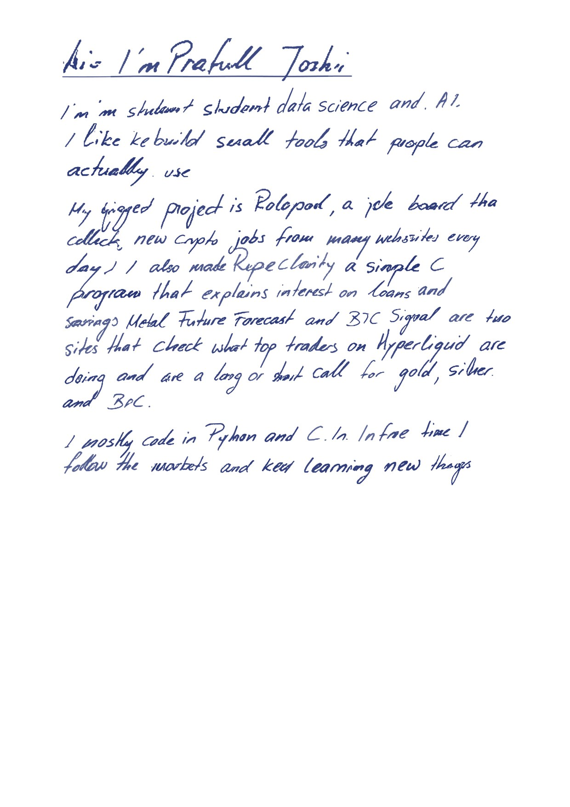
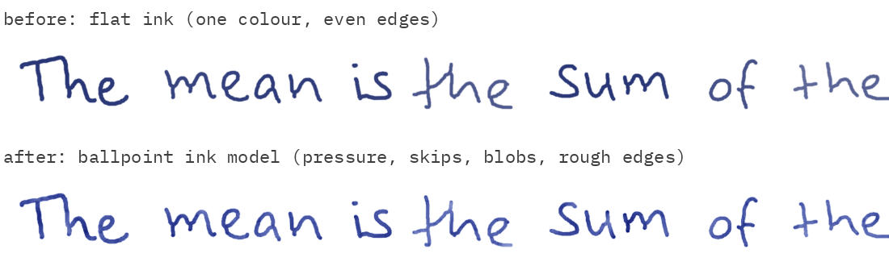

# ductus

Text to handwritten A4 pages that look written by a person: notes, worked maths, lists and
prose, with plain readable letters and, optionally, the size, spacing and ink of your own
writing measured from photos.

[Source code and install](https://github.com/PrafullJ0shi/ductus)

## Gallery

| Definitions | Worked example |
|---|---|
|  |  |
| **Checklist** | **Intro** |
|  |  |

## Pens and ink

Six pens and three tip sizes, inked at 600 dpi with a physical ink model. See
[pens and tip sizes](PENS.md) and [the ink model](INK.md).

## Read more

- [Architecture](ARCHITECTURE.md) and [method](METHOD.md)
- [Realism checklist](REALISM.md), [pens](PENS.md), [ink model](INK.md), [writer profile and habits](HABITS.md)
- [Benchmark](BENCHMARK.md), [evaluation](EVALUATION.md) and [comparison with other tools](COMPARISON.md)
- [Research survey](RESEARCH.md)
- [Command line](CLI.md), [style guide](STYLE_GUIDE.md), [FAQ](FAQ.md)
